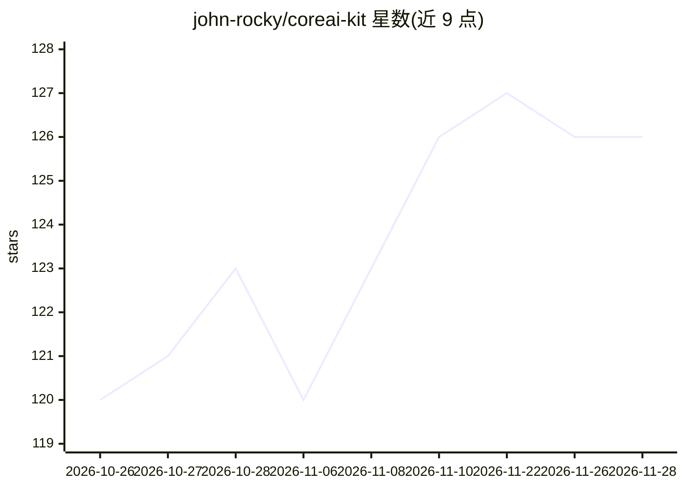

# john-rocky/coreai-kit

⭐ 126 · Swift · BSD-3-Clause · 推送 2026-11-16 · [GitHub](https://github.com/john-rocky/coreai-kit) · [官网](https://john-rocky.github.io/coreai-kit/) · 个人维护

**在 iPhone/Mac 上运行 Apple Core AI 模型的 Swift SDK**

社区维护的 Swift 包（非 Apple 官方），封装 iOS 27 / macOS 27 的 Core AI 运行时：内置 80 条模型目录（固定 Hugging Face revision），按设备自动选择构建、下载并缓存模型；提供一行式调用（转录、摘要、检测、语音合成、深度估计、OCR）与模型级 API（ChatSession/KitLanguageModel/KitVisionModel），并通过 KitLanguageModel 接入 Apple FoundationModels 的 LanguageModelSession。需 Xcode 27 与 macOS 27 / iOS 27 真机运行，CoreAI 框架不在模拟器 SDK 中。附带 35 个示例工程。

## 筛选速览

| 维度 | 判定 | 备注 |
|---|---|---|
| AI 角色 | `ai-ecosystem` | LLM/agent 周边工具 |
| 许可风险 | `permissive` | BSD-3-Clause |
| 部署形态 | `None` |  |
| 模型依赖 | — | README 未给出锁定关系 |
| 硬件要求 | — | 无带数字的原话,不猜 |
| 安装摩擦 | `low` | 无编译、无系统依赖或容器化 |
| 成熟度 | — | 结构信号不足 |

## 能力要点

- 内置 80 条目模型目录，自动下载与缓存，无需 API key 与模型转换
- 一行式调用：transcribe/summarize/detect/speak/estimateDepth 等
- KitLanguageModel 接入 Apple FoundationModels，增加工具调用与引导生成
- systemone serve 提供 HTTP 接口供 Swift 之外程序调用

## 适用场景

- 在 iOS/macOS 应用内运行本地聊天与视觉模型
- 真机上做语音转写、OCR、目标检测、深度估计
- 通过 LanguageModelSession 为系统模型会话挂载本地 Core AI 模型

## 场景标签

`语音合成` `语音识别` `OCR` `目标检测` · 领域:内容生成

## 证据(README 行号)

> L5: Download a tested Core AI model and run it in your Swift app. Core AI is Apple's on-device ML runtime in iOS 27 / ma
> L18: Most tasks take one line. CoreAIKit finds the model and caches it for you:
> L97: `KitLanguageModel` plugs compatible Core AI chat bundles into the system `LanguageModelSession`, the same API you u

## 星数曲线

2026-10-26 120 → 2026-11-28 126（+6）

---
*卡片 v1 · prompt 1.4 · 生成 2026-11-28 · 置信度 high · 依据 README sha `a080a303785d` · [字段定义](../../DATASET.md)*
