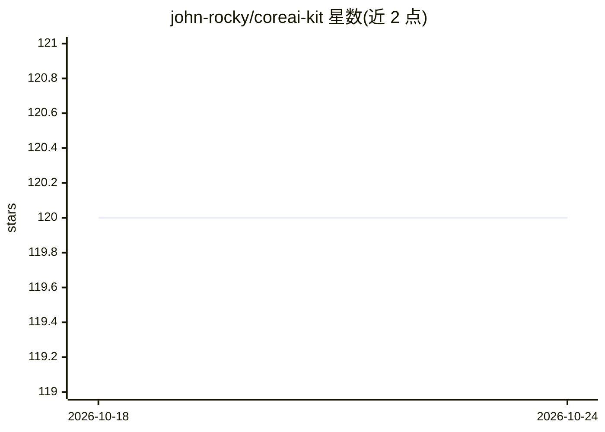

# john-rocky/coreai-kit

⭐ 120 · Swift · BSD-3-Clause · 推送 2026-10-23 · [GitHub](https://github.com/john-rocky/coreai-kit) · [官网](https://john-rocky.github.io/coreai-kit/) · 个人维护

**在 iPhone/Mac 上运行 Apple Core AI 模型的 Swift SDK**

由 Daisuke Majima 维护的社区 Swift 包（非 Apple 官方），封装 Apple Core AI 框架：内置模型目录，从 Hugging Face 下载并缓存 chat/vision/speech 模型（如 Qwen3 0.6B），提供 ChatSession、KitLanguageModel（适配 FoundationModels 的 LanguageModelSession）等模型级 API，以及 24 个单行任务算子（transcribe/detect/redact 等）。另附 systemone 独立二进制，在设备端提供类型化决策 API、HTTP 服务与 MCP server。限制：需 Xcode 27 与 macOS 27/iOS 27 真机，模拟器 SDK 不含 CoreAI 框架。

## 筛选速览

| 维度 | 判定 | 备注 |
|---|---|---|
| AI 角色 | `ai-ecosystem` | LLM/agent 周边工具 |
| 许可风险 | `permissive` | BSD-3-Clause |
| 部署形态 | `None` |  |
| 模型依赖 | — | README 未给出锁定关系 |
| 硬件要求 | — | 无带数字的原话,不猜 |
| 安装摩擦 | `low` | 无编译、无系统依赖或容器化 |
| 成熟度 | — | 结构信号不足 |

## 能力要点

- 模型目录 + Hugging Face 下载与缓存（支持 HF_TOKEN、镜像、Xet trait）
- KitLanguageModel 将 chat 模型适配 Apple LanguageModelSession
- CoreAIOps 提供 24 个单行任务算子（转录/检测/摘要/脱敏等）
- systemone 二进制：设备端类型化决策 + /v1/systemone HTTP + MCP server

## 适用场景

- 在 iOS/macOS 应用中集成端侧 chat、vision、speech 模型
- 从托管决策 API 切换到本地 Core AI 模型推理
- 通过 MCP 给 Claude/Codex/Cursor 等 agent 挂载 decide 决策工具

## 场景标签

`语音识别` `多模态` · 领域:感知与多模态

## 证据(README 行号)

> L8: Download a tested Core AI model and run it in your Swift app. CoreAIKit handles model
> L110: `KitLanguageModel` adapts **chat bundles** to Apple's `LanguageModelSession`. The
> L160: **Model-level APIs** when you want control — `ChatSession` (the quickstart above),

## 星数曲线

2026-10-18 120 → 2026-10-24 120（+0）

---
*卡片 v1 · prompt 1.4 · 生成 2026-10-23 · 置信度 high · 依据 README sha `df1b3af10b6f` · [字段定义](../../DATASET.md)*
