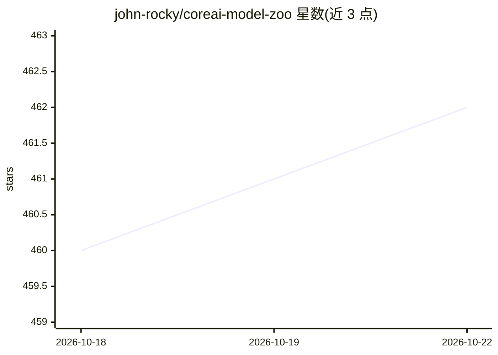

# john-rocky/coreai-model-zoo

⭐ 464 · Python · NOASSERTION · 推送 2026-10-15 · [GitHub](https://github.com/john-rocky/coreai-model-zoo) · [官网](https://john-rocky.github.io/coreai-model-zoo/) · 个人维护

**Apple Core AI 模型动物园：可下载模型与转换配方及验证记录**

面向 Apple iOS 27 / macOS 27 的 Core AI 运行时（Core ML 后继者）的模型目录：提供已转换为 .aimodel 格式的可下载 LLM/VLM/TTS/语音模型，每个模型附带生成它的 recipe.toml 转换配方（zoo_convert.py 重跑）、与原始模型比对的验证记录（zoo_verify.py 描述校验、coreai_gate.py 数值 gate 逐 token 比对）。支持社区署名移植，收录 iPhone 实测基准。开发者经 CoreAIKit Swift 库在设备端集成推理。限制：大模型多为 Mac-only，转换非字节确定性。

## 筛选速览

| 维度 | 判定 | 备注 |
|---|---|---|
| AI 角色 | `ai-ecosystem` | LLM/agent 周边工具 |
| 许可风险 | `none` | NOASSERTION |
| 部署形态 | `desktop` | 安装包/桌面程序 |
| 模型依赖 | — | README 未给出锁定关系 |
| 硬件要求 | — | 无带数字的原话,不猜 |
| 安装摩擦 | `low` | 无编译、无系统依赖或容器化 |
| 成熟度 | — | 结构信号不足 |

## 能力要点

- 每个模型附带 recipe.toml 转换配方，可用 zoo_convert.py 重跑
- zoo_verify.py 校验包描述与源模型一致性，coreai_gate.py 做 fp32 逐 token 数值比对并发布 transcript
- 支持社区移植（署名 + 自有 HF 命名空间发布），收录 iPhone/Mac 实测基准
- CoreAIKit 0.4.1 提供 Swift 集成路径，推理与提示保留在设备端

## 适用场景

- 为 iPhone/Mac 应用查找并下载已验证的 Core AI 模型
- 重跑或改编转换配方，把自己的模型移植到 .aimodel 格式
- 核验模型包与其源模型的一致性与数值正确性
- 查看各模型在具体硬件上的实测吞吐数据

## 场景标签

 · 领域:端侧 LLM/模型转换与分发

## 证据(README 行号)

> L11: **Converted models + conversion recipes** for Apple **Core AI** (`.aimodel`, iOS 27 / macOS 27):
> L72: ## Rebuild a bundle — the conversion recipes

## 星数曲线

2026-10-18 460 → 2026-10-22 462（+2）

---
*卡片 v1 · prompt 1.4 · 生成 2026-10-21 · 置信度 high · 依据 README sha `1f31f3337064` · [字段定义](../../DATASET.md)*
