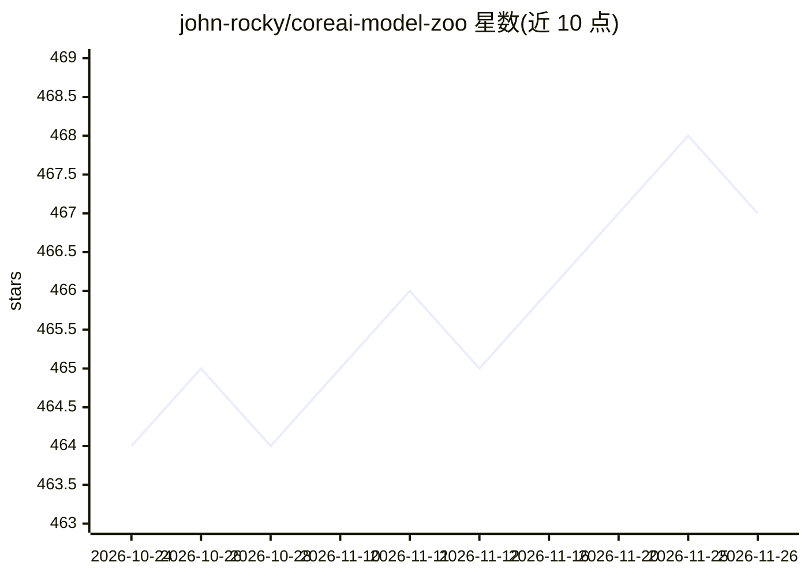

# john-rocky/coreai-model-zoo

⭐ 467 · Python · NOASSERTION · 推送 2026-11-20 · [GitHub](https://github.com/john-rocky/coreai-model-zoo) · [官网](https://john-rocky.github.io/coreai-model-zoo/) · 个人维护

**面向 iOS/Mac 开发者的 Apple Core AI 转换模型目录与配方集**

针对 Apple Core AI 运行时的社区模型目录，收录 90+ 个已转换的开放权重模型，每个附转换配方与输出校验记录，可从 Hugging Face 下载。使用方式包括：通过 CoreAI Zoo 应用直接下载运行；或经 CoreAIKit Swift 包按目录 id 加载到自有应用；也可按 PORTING.md 从 HF checkpoint 自行转换并复现。提供面向编码 agent 的插件技能（复现/移植模型），以及错误索引与知识笔记。模型权重遵循各自许可。

## 筛选速览

| 维度 | 判定 | 备注 |
|---|---|---|
| AI 角色 | `ai-knowledge` | 知识聚合/清单类 |
| 许可风险 | `none` | NOASSERTION |
| 部署形态 | `None` |  |
| 模型依赖 | — | README 未给出锁定关系 |
| 硬件要求 | — | 无带数字的原话,不猜 |
| 安装摩擦 | `low` | 无编译、无系统依赖或容器化 |
| 成熟度 | — | 结构信号不足 |

## 能力要点

- 90+ 个转换模型的分类目录（聊天/视觉/语音/生成/时序等）
- 每个模型附转换配方与逐条校验记录
- CoreAIKit Swift 包按目录 id 加载模型
- 提供 Claude Code/Codex CLI/Gemini CLI 的 agent 技能插件

## 适用场景

- 在 iPhone/Mac 应用中快速接入端侧模型
- 查找某类任务（ASR、OCR、目标检测、TTS）的 Core AI 可用模型
- 把新的 PyTorch 模型移植为 .aimodel 并发布到目录
- 在端侧设备上复跑社区基准测试

## 场景标签

`精选清单` · 领域:学习与行业

## 证据(README 行号)

> L6: Core AI is Apple's on-device ML runtime in iOS 27 / macOS 27 and the successor to Core ML. This repo is a community 
> L55: To port a new model, follow `PORTING.md` from a Hugging Face checkpoint to a verified `.aimodel` on an iPhone. To r
> L63: This repo ships a plugin with two skills for coding agents. An agent without plugin support can read `AGENTS.md` in

## 星数曲线

2026-10-24 464 → 2026-11-26 467（+3）

---
*卡片 v1 · prompt 1.4 · 生成 2026-11-25 · 置信度 high · 依据 README sha `5caff73fc0ef` · [字段定义](../../DATASET.md)*
