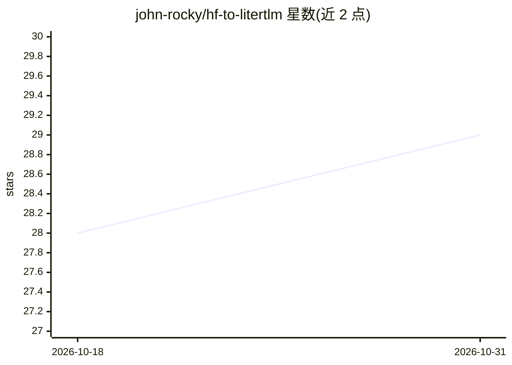

# john-rocky/hf-to-litertlm

⭐ 29 · Python · Apache-2.0 · 推送 2026-10-30 · [GitHub](https://github.com/john-rocky/hf-to-litertlm) · [官网](https://john-rocky.github.io/) · 个人维护

**把 Hugging Face 开源 LLM/VLM 转换为 LiteRT-LM 端侧包的转换器**

面向端侧 AI 开发者的模型转换工具：将 Hugging Face 开放权重 LLM/VLM 转为 .litertlm 包，运行于 Google LiteRT-LM 运行时（Android/iOS/macOS/Windows/Linux）。已发布 88 个转换结果，附各设备实测解码速度与单命令复现脚本；lock 文件记录 Hub commit、文件 sha256 与包版本，可逐字节重建验证。转换脚本拒绝无法如实转换的仓库（gated、远程代码、预量化）。提供 uv 本地运行与 PyPI 免 clone 两种方式，配套 Android（hfmodels）与 iOS（swift-litert-lm）加载路径。

## 筛选速览

| 维度 | 判定 | 备注 |
|---|---|---|
| AI 角色 | `ai-ecosystem` | LLM/agent 周边工具 |
| 许可风险 | `permissive` | Apache-2.0 |
| 部署形态 | `library` | 以包/库形式分发 |
| 模型依赖 | — | README 未给出锁定关系 |
| 硬件要求 | — | 无带数字的原话,不猜 |
| 安装摩擦 | `low` | 无编译、无系统依赖或容器化 |
| 成熟度 | — | 结构信号不足 |

## 能力要点

- 88 个已发布转换，附各设备实测解码速度与单命令复现
- lock 文件记录 Hub commit、sha256 与包版本，支持字节级重建校验
- 拒绝 gated/远程代码/预量化仓库并给出 JSON 原因
- Android/iOS SDK 可直接按 repo 名加载已发布包，无需再转换

## 适用场景

- 把开源 Hugging Face 模型转到手机等端侧设备运行
- 用单命令复现已发布模型的转换过程并校验一致性
- 为 React Native / Flutter 端侧 AI 应用查找可直接加载的模型包

## 场景标签

 · 领域:端侧 LLM 工具链/模型部署

## 证据(README 行号)

> L3: Convert open-weight Hugging Face LLMs and VLMs into `.litertlm` bundles for Google's LiteRT-LM
> L21: uv run litert-lm run out/<model>/*.litertlm --prompt "Hello"         # same bundle runs on a phone: see below
> L42: In an Android app, a published bundle is one Gradle line and a few lines of Kotlin through

## 星数曲线

2026-10-18 28 → 2026-10-31 29（+1）

---
*卡片 v1 · prompt 1.4 · 生成 2026-10-26 · 置信度 high · 依据 README sha `6acc21ba07d8` · [字段定义](../../DATASET.md)*
