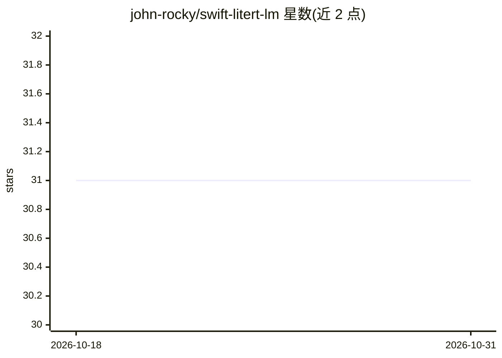

# john-rocky/swift-litert-lm

⭐ 31 · Swift · Apache-2.0 · 推送 2026-10-05 · [GitHub](https://github.com/john-rocky/swift-litert-lm) · [官网](https://john-rocky.github.io/) · 个人维护

**在 iPhone 上运行 Gemma 4 的 Swift 包：Metal GPU、多模态、FM 后端**

封装 Google LiteRT-LM 运行时的 Swift Package，面向 iOS/macOS 开发者：Easy 模式（LiteRTChat）提供 Gemma 4 E2B 的应用内下载、Metal GPU 推理与文本/图像/音频多模态；FM 模式（LiteRTLanguageModel）将 LiteRT 实现为 Apple Foundation Models API（iOS 27）的第三方本地后端，支持 respond/stream、@Generable 引导生成与工具调用。模型不打包进应用，首次启动从 Hugging Face 下载（约 2.6 GB）。Metal GPU 需物理设备上的签名应用，模拟器回退 CPU。附 ChatGPT/Claude 风格示例 app 与无头自测。

## 筛选速览

| 维度 | 判定 | 备注 |
|---|---|---|
| AI 角色 | `ai-ecosystem` | LLM/agent 周边工具 |
| 许可风险 | `permissive` | Apache-2.0 |
| 部署形态 | `None` |  |
| 模型依赖 | — | README 未给出锁定关系 |
| 硬件要求 | — | 无带数字的原话,不猜 |
| 安装摩擦 | `low` | 无编译、无系统依赖或容器化 |
| 成熟度 | `idea` | |

## 能力要点

- Easy 模式：一行依赖、五行代码跑通流式 Gemma 4 对话，应用内可断点续传下载模型
- FM 模式：LiteRT 作为 Apple Foundation Models API 的本地后端，支持引导生成与工具调用
- 文本+图像+音频多模态，Metal GPU 推理（iPhone 17 Pro 实测约 50 tok/s 文本解码）
- 内存安全：拒绝加载会触发 jetsam 的模型，可运行任意 Hugging Face .litertlm 或本地文件

## 适用场景

- 在 iOS 应用中集成端侧 Gemma 4 多模态对话
- 通过 Foundation Models API 驱动 LiteRT 做引导生成与工具调用
- 构建离线语音转写、图像问答类 app（已有 VivaDicta、EyePal 使用）

## 场景标签

`多模态` `推理引擎` · 领域:感知与多模态

## 证据(README 行号)

> L34: This package puts two faces on Google's official LiteRT-LM runtime:
> L39: Apple opened Foundation Models to custom backends in iOS 27 — any type conforming to its `LanguageModel` protocol c

## 星数曲线

2026-10-18 31 → 2026-10-31 31（+0）

---
*卡片 v1 · prompt 1.4 · 生成 2026-10-26 · 置信度 high · 依据 README sha `6d740d6a16e8` · [字段定义](../../DATASET.md)*
