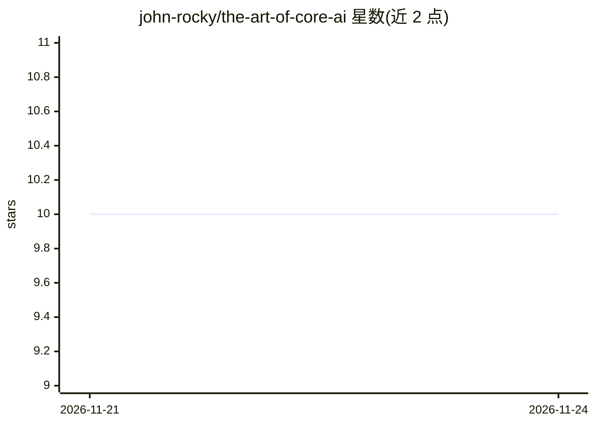

# john-rocky/the-art-of-core-ai

⭐ 10 · Shell · 推送 2026-09-14 · [GitHub](https://github.com/john-rocky/the-art-of-core-ai) · [官网](https://john-rocky.github.io/the-art-of-core-ai/) · 个人维护 · 中文 README

**面向 iOS/macOS 开发者的 Core AI 端侧部署实战书**

一本免费在线动手书：围绕 Apple Core AI 框架，将 30+ 模型（LLM、MoE、扩散 LLM、语音、音乐、视觉）部署到真实 iPhone 与 Mac，全部数据来自实测并附复现路径。正文 13 章阐述以字节搬运量为核心的论点，另配 7 个 Lab 覆盖模型转换、Swift 集成、iPhone 部署与测量；配套知识库、81 个模型的 zoo 与 CoreAIKit Swift 库。英文版在线阅读，日文原版发布于 Zenn。

## 筛选速览

| 维度 | 判定 | 备注 |
|---|---|---|
| AI 角色 | `ai-knowledge` | 知识聚合/清单类 |
| 许可风险 | `none` | — |
| 部署形态 | `None` |  |
| 模型依赖 | — | README 未给出锁定关系 |
| 硬件要求 | — | 无带数字的原话,不猜 |
| 安装摩擦 | `low` | 无编译、无系统依赖或容器化 |
| 成熟度 | — | 结构信号不足 |

## 能力要点

- 30+ 模型在真实 iPhone/Mac 上的实测数据，均可复现
- 7 个动手 Lab：从模型导出、Swift 驱动到 iPhone 部署与测量
- 配套 coreai-model-zoo（81 个模型）与 CoreAIKit Swift 运行库
- 自定义 Metal 内核与 ANE/GPU 编写规则的知识库

## 适用场景

- 学习如何把训练好的模型转换并部署到 iPhone
- 为端侧 LLM 应用做性能与内存实测
- 通过 Swift 一行代码运行已转换的 Core AI 模型

## 场景标签

`推理引擎` `模型量化` `教程课程` · 领域:学习与行业

## 证据(README 行号)

> L8: This book builds that thesis one measured fact at a time: 30+ models shipped to real iPhones and
> L36: |Lab|Title|
> L48: Every number in this book was measured on the ports in the Core AI model zoo, and the working

## 星数曲线

2026-11-21 10 → 2026-11-24 10（+0）

---
*卡片 v1 · prompt 1.4 · 生成 2026-11-21 · 置信度 high · 依据 README sha `e84f9d696e0b` · [字段定义](../../DATASET.md)*
