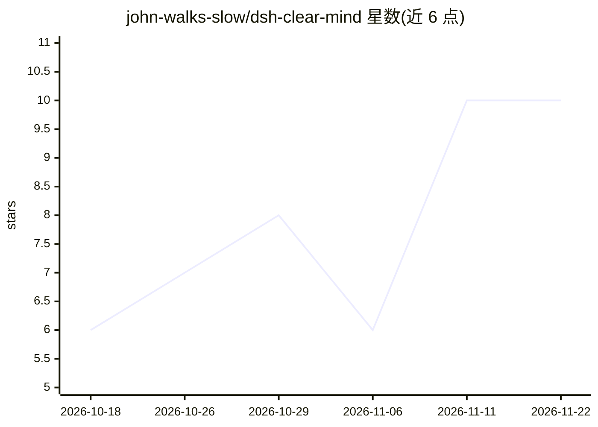

# john-walks-slow/dsh-clear-mind

⭐ 10 · TypeScript · MIT · 推送 2026-10-26 · [GitHub](https://github.com/john-walks-slow/dsh-clear-mind) · 个人维护 · 中文 README

**让 agent 自主压缩上下文的 DeepSeek Harness 插件**

面向 DeepSeek Harness（cordis 平台）的插件，注册 `mind_map` 与 `clear_mind` 两个工具：前者展示当前上下文表面（seq、角色、token 重量、区间边界标记），后者由模型自主选定区间、生成检查点并替换历史，走平台原生 compaction 事务。附带可展开的 GUI 压缩行、阈值触发的主动提醒、影子价格协议与防退化护栏；人类侧 append-only 日志不变。仅注册给根代理，需 Node ≥ 22.5 与 dsh 0.1.2-rc.1 锁定版本，零网络、零外部服务。

## 筛选速览

| 维度 | 判定 | 备注 |
|---|---|---|
| AI 角色 | `ai-ecosystem` | LLM/agent 周边工具 |
| 许可风险 | `permissive` | MIT |
| 部署形态 | `library` | 以包/库形式分发 |
| 模型依赖 | — | README 未给出锁定关系 |
| 硬件要求 | — | 无带数字的原话,不猜 |
| 安装摩擦 | `low` | 无编译、无系统依赖或容器化 |
| 成熟度 | — | 结构信号不足 |

## 能力要点

- 模型自主调用 clear_mind 将选定历史区间替换为自写检查点
- mind_map 提供带 seq 身份与区间边界标记的上下文地图
- 阈值触发的 system-reminder 主动提醒与 GUI 可审计墓碑
- 影子价格协议与平台压缩引擎逐字节同构，可回退可审计

## 适用场景

- 长会话中失败探索与冗余工具输出拖累上下文时清理历史
- 为 agent 会话保留人类侧完整记录的同时压缩模型可见上下文
- 按 agent preset 自定义清理指引提示词

## 场景标签

`Agent 记忆` · 领域:Agent 开发

## 证据(README 行号)

> L6: 让模型自主压缩指定区间上下文的 DeepSeek Harness 插件（cordis plugin）：当失败探索和大输出把上下文拖累时，模型调用 `clear_mind`「清空脑子」——把选定区间的对话历史替换成自己写的检查点，只留
> L93: - **依赖**：`@deepseek-ai/cordis` 4.0.2 / `@deepseek-ai/dsh-session` · `dsh-llm` · `dsh-compaction` · `dsh-tools` 0.1.
> L44: - **仅根代理注册工具**：`mind_map` / `clear_mind` 只注册给 root agent；子代理上下文天然短命，保持平台自动压缩，不开放自改历史。

## 星数曲线

2026-10-18 6 → 2026-11-22 10（+4）

---
*卡片 v1 · prompt 1.4 · 生成 2026-11-19 · 置信度 high · 依据 README sha `37b4fe20ece2` · [字段定义](../../DATASET.md)*
