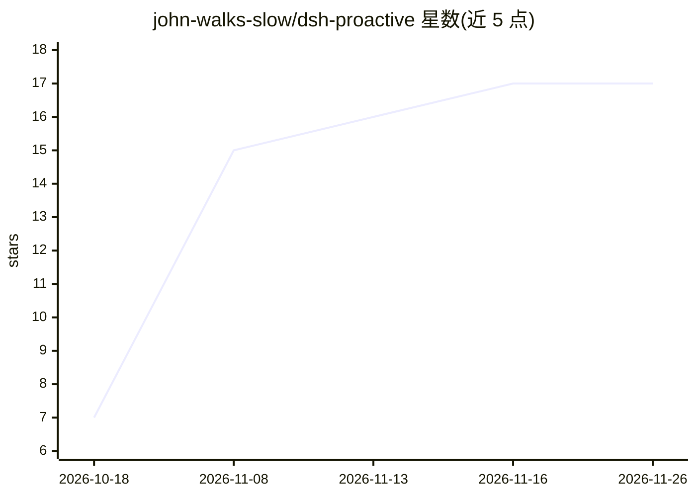

# john-walks-slow/dsh-proactive

⭐ 17 · TypeScript · 推送 2026-10-26 · [GitHub](https://github.com/john-walks-slow/dsh-proactive) · 个人维护 · 中文 README

**DSH 插件：让 AI 模型自设宿主级定时闹钟唤醒冷会话**

DeepSeek Harness（DSH）的插件，为模型注册 6 个 host 级工具，可按 once/every/cron/文件表四种类型自设宿主级闹钟，支持抖动、免打扰时段、每日投递限额与静默门禁。到点由宿主进程唤醒已冷却或已关闭页面的会话执行一轮对话；无事可报时调用 proactive_reclaim 将唤醒折叠为约 70B 的墓碑。提供 SSE 实时同步的 Web 双端面板。需 dsh 0.2.0-rc.1 及以上，数据持久化于 $DSH_HOME/proactive/。

## 筛选速览

| 维度 | 判定 | 备注 |
|---|---|---|
| AI 角色 | `ai-ecosystem` | LLM/agent 周边工具 |
| 许可风险 | `none` | — |
| 部署形态 | `None` |  |
| 模型依赖 | locked-api |  |
| 硬件要求 | — | 无带数字的原话,不猜 |
| 安装摩擦 | `low` | 无编译、无系统依赖或容器化 |
| 成熟度 | `idea` | |

## 能力要点

- 闹钟调度提升至宿主进程层级，服务重启自愈，可唤醒冷会话
- 四种调度类型：once/every/cron/文件表句柄（JSON 时间表同步为子闹钟）
- 抖动、免打扰时段、每日投递限额、min_idle 静默门禁等护栏
- proactive_reclaim 静默收尾：整轮唤醒折叠为轻量墓碑，不污染长期上下文

## 适用场景

- 让 agent 按日程主动发起跟进提醒
- 自动化 Agent 通过工作区时间表文件安排每日自主唤醒任务
- 通过面板审计与调试闹钟的真实唤醒表现

## 场景标签

`工作流自动化` · 领域:效率与自动化

## 证据(README 行号)

> L6: 让 DeepSeek Harness（DSH）的 AI 模型具备**主动跟进（Proactive Wake-up）**能力：模型可按需自设 host 宿主级定时闹钟。到点由宿主唤醒目标会话执行一轮对话——即使会话早已冷却、浏览器页面
> L55: 插件为每个 root agent 注册以下 host 级工具（冷唤醒会话与普通日常会话均完全可用）：

## 星数曲线

2026-10-18 7 → 2026-11-26 17（+10）

---
*卡片 v1 · prompt 1.4 · 生成 2026-11-18 · 置信度 high · 依据 README sha `9298e4d943e9` · [字段定义](../../DATASET.md)*
