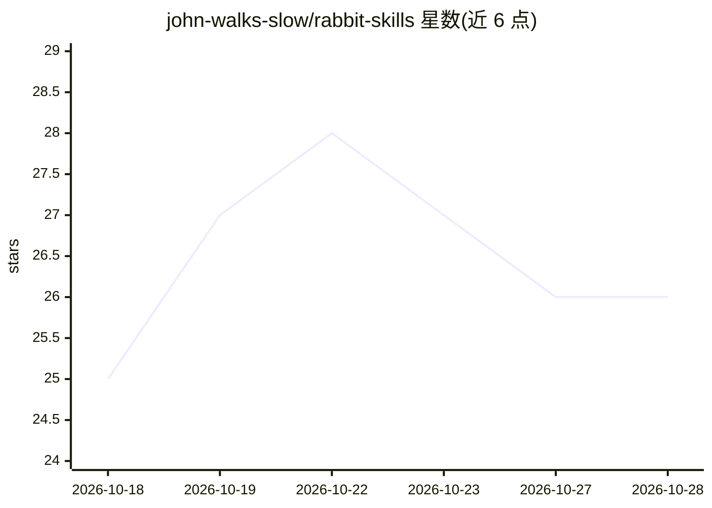

# john-walks-slow/rabbit-skills

⭐ 26 · TypeScript · 推送 2026-10-28 · [GitHub](https://github.com/john-walks-slow/rabbit-skills) · [官网](https://john-walks-slow.github.io/rabbit-skills/) · 个人维护 · 中文 README

**轻量 Coding Agent 配置套件：指令、子代理与工作流技能**

面向中等规模 AI 原生项目开发的 Coding Agent 配置套件，包含系统指令（输出/编码/文档/协作规范）、5 个子代理（调研、代码检视、端到端测试等）和 20 余个技能命令，覆盖调研规划、根因排障、迭代交付三条工作流，以及 worktree 隔离开发、多 agent 并行提交、任务分派与项目领导等场景。基于 APM 规范分发，兼容 19 个主流 Agent 工具（Copilot / Claude Code / Cursor / Codex / Gemini CLI 等），可全局或按工具安装；修饰器与任务管理工作流标注为实验性。

## 筛选速览

| 维度 | 判定 | 备注 |
|---|---|---|
| AI 角色 | `ai-ecosystem` | LLM/agent 周边工具 |
| 许可风险 | `none` | — |
| 部署形态 | `None` |  |
| 模型依赖 | — | README 未给出锁定关系 |
| 硬件要求 | — | 无带数字的原话,不猜 |
| 安装摩擦 | `low` | 无编译、无系统依赖或容器化 |
| 成熟度 | `idea` | |

## 能力要点

- 三条通用工作流：调研规划 / 根因排障 / 迭代交付
- 5 个子代理（deep-researcher / reviewer / e2e-tester / expert / auto-human）
- 基于 APM 规范，兼容 19 个主流 Agent 工具
- 20 余个实用技能：worktree 隔离、并行提交、cross-check 复核、任务管理等

## 适用场景

- 为我的 Coding Agent 配置调研规划、排障与交付工作流
- 多 agent 并发开发时用 worktree 隔离与安全提交
- 让 Agent 整理杂乱任务并分派子代理推进项目

## 场景标签

`编码 Agent` `多智能体` · 领域:Agent 开发

## 证据(README 行号)

> L3: 轻量、松弛、有效的 Coding Agent 配置套件。适合中等规模的 AI 原生项目开发。
> L18: - 基于 APM (Agent Package Manager) 规范，兼容 19 个主流 Agent 工具（Copilot / Claude Code / Cursor / Codex / Gemini CLI / Windsu
> L100: ### Agents（代理和子代理）

## 星数曲线

2026-10-18 25 → 2026-10-28 26（+1）

---
*卡片 v1 · prompt 1.4 · 生成 2026-10-26 · 置信度 high · 依据 README sha `4afc34822928` · [字段定义](../../DATASET.md)*
