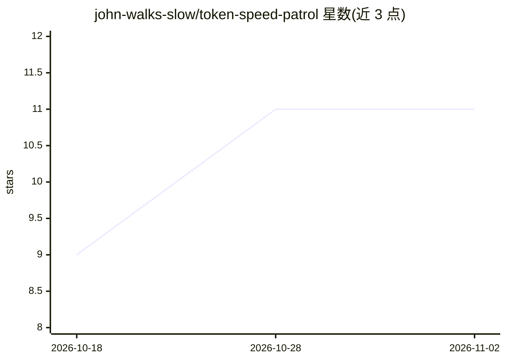

# john-walks-slow/token-speed-patrol

⭐ 11 · Python · MIT · 推送 2026-11-01 · [GitHub](https://github.com/john-walks-slow/token-speed-patrol) · [官网](https://john-walks-slow.github.io/token-speed-patrol/) · 个人维护 · 中文 README

**跑在 GitHub Actions 上的 LLM API 测速巡检与静态看板**

基于 GitHub Actions 定时任务的 LLM API 服务商测速工具：按 patrol.json 配置向 OpenAI 兼容/Anthropic/OpenCode 端点发请求，测 TTFT、TPS、ITL、思考时长与成功率，结果以 JSONL 提交回仓库并通过 GitHub Pages 发布静态看板，历史可经 git 追溯。支持动态模型发现（whitelist/blacklist regex 过滤）、连续失败 5 次自动拉黑、密钥仅经 Secrets 注入不落盘。默认配置 6 个免费端点（Groq、NVIDIA NIM、Cloudflare、OpenRouter :free、ModelScope、Cerebras），并内置 OpenCode Zen 免费层握手复刻。面向希望零服务器监测多家 LLM API 速度与可用性的开发者。

## 筛选速览

| 维度 | 判定 | 备注 |
|---|---|---|
| AI 角色 | `ai-ecosystem` | LLM/agent 周边工具 |
| 许可风险 | `permissive` | MIT |
| 部署形态 | `library` | 以包/库形式分发 |
| 模型依赖 | — | README 未给出锁定关系 |
| 硬件要求 | — | 无带数字的原话,不猜 |
| 安装摩擦 | `low` | 无编译、无系统依赖或容器化 |
| 成熟度 | — | 结构信号不足 |

## 能力要点

- GitHub Actions 定时巡检 + Pages 静态看板，零服务器部署
- TTFT/TPS/ITL/思考时长/成功率指标，口径与 llmperf/lmsys 一致
- 动态模型发现与 whitelist/blacklist regex 过滤，自动跟随上游增删
- 连续失败 5 次自动拉黑、成功即恢复，密钥经 Secrets 注入不落盘

## 适用场景

- 我在挑选免费 LLM API 时想对比各家实时速度和成功率
- 长期监测我依赖的 LLM 网关性能趋势并留存历史
- 自动跟踪服务商新上线的免费模型

## 场景标签

`LLM 可观测性` · 领域:评测与运维

## 证据(README 行号)

> L3: LLM API 定时巡检 + 静态看板，跑在 GitHub Actions 上，零服务器、零成本。
> L5: GitHub Actions 定时对你的 LLM API 服务商测速（TTFT / TPS / 思考时长 / 成功率），结果以 JSONL 提交回仓库，GitHub Pages 发布看板展示趋势。所有数据公开可追溯——每一行历史都能
> L113: - **TPS** = tokens_generated / 端到端总耗时（与 llmperf/lmsys 等主流基准一致）。

## 星数曲线

2026-10-18 9 → 2026-11-02 11（+2）

---
*卡片 v1 · prompt 1.4 · 生成 2026-11-02 · 置信度 high · 依据 README sha `ab50f58f62dd` · [字段定义](../../DATASET.md)*
