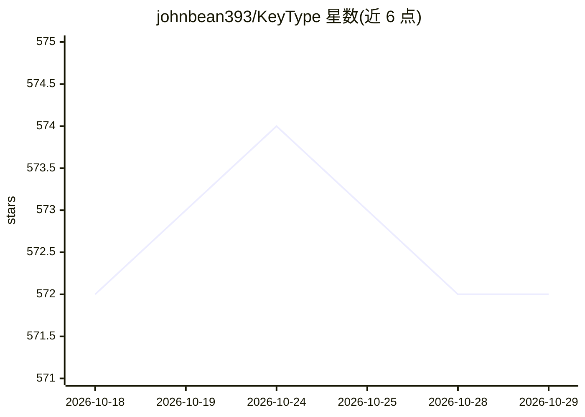

# johnbean393/KeyType

⭐ 572 · Swift · MIT · 推送 2026-08-29 · [GitHub](https://github.com/johnbean393/KeyType) · 个人维护

**macOS 全系统 Tab 补全工具：本地 LLM 预测续写**

macOS 上的开源系统级 tab 自动补全工具：监控任意应用中聚焦的文本输入框，调用本地 LLM 在光标处预测短续写，以 ghost text 形式呈现，按 Tab 接受。全部推理在设备端完成。定位为闭源应用 Cotypist 的 MIT 许可替代品。通过 DMG 安装包分发，开发构建需 macOS 14+ 与 Xcode，仓库内含 AutocompleteCore 与 Prompting 等 Swift 包。

## 筛选速览

| 维度 | 判定 | 备注 |
|---|---|---|
| AI 角色 | `ai-native` | 本体是模型或模型工具 |
| 许可风险 | `permissive` | MIT |
| 部署形态 | `desktop` | 安装包/桌面程序 |
| 模型依赖 | — | README 未给出锁定关系 |
| 硬件要求 | — | 无带数字的原话,不猜 |
| 安装摩擦 | `low` | 无编译、无系统依赖或容器化 |
| 成熟度 | — | 结构信号不足 |

## 能力要点

- 监控任意应用聚焦文本框，系统级触发补全
- 本地 LLM 在设备端预测短续写
- ghost text + Tab 接受的交互形式
- MIT 许可，DMG 安装包分发

## 适用场景

- 在 macOS 任意应用中打字时获得续写建议
- 不联网使用本地模型的文本补全
- 寻找 Cotypist 的开源替代

## 场景标签

 · 领域:桌面工具/文本补全

## 证据(README 行号)

> L17: It watches the focused text field across any app, predicts a short continuation at the cursor
> L18: using a **local LLM**, and offers it as ghost text that you accept with **Tab**.

## 星数曲线

2026-10-18 572 → 2026-10-29 572（+0）

---
*卡片 v1 · prompt 1.4 · 生成 2026-10-21 · 置信度 high · 依据 README sha `aa0a2be75c73` · [字段定义](../../DATASET.md)*
