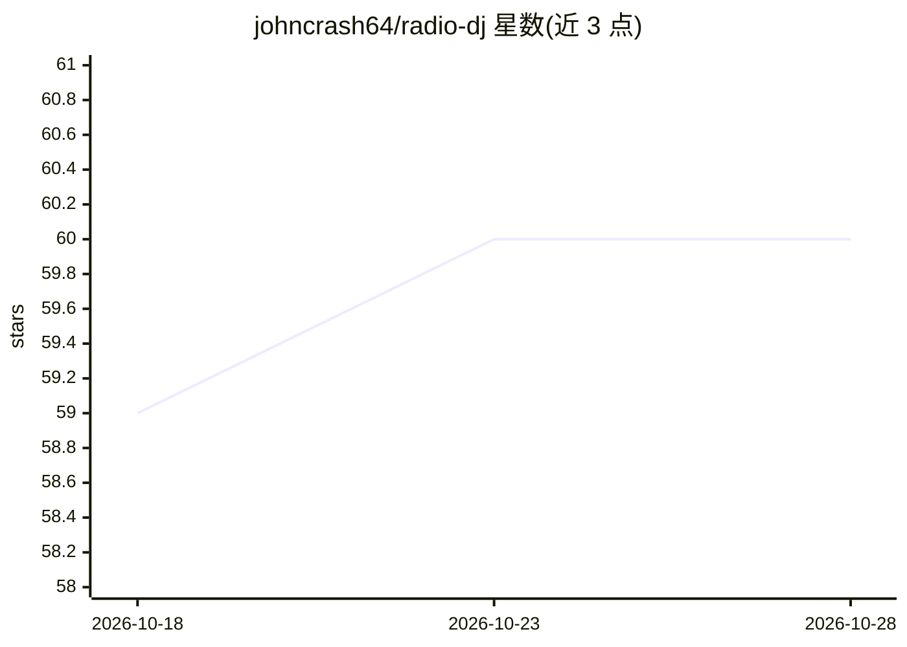

# johncrash64/radio-dj

⭐ 60 · Go · MIT · 推送 2026-08-12 · [GitHub](https://github.com/johncrash64/radio-dj) · 个人维护

**单个 Go 二进制运行 24/7 AI DJ 网络电台**

radio-dj 是一个约 9 MB 的 Go 单二进制程序，指向本地音乐文件夹后即可广播持续 Icecast MP3 流。内置 LLM DJ：由 LLM Director 一次结构化调用规划每批曲目与串场词（曲目介绍、时间、真实天气、网络搜索趣闻、点歌播报），经 TTS 合成后播出，用 sidechaincompress 在歌曲中压低音乐插话。支持 BYOK（GLM/OpenAI/OpenRouter/Ollama/Groq 或任意 OpenAI 兼容接口），技能段以文本文件可编辑，无 Docker，依赖 icecast 与 ffmpeg，可安装为 launchd/systemd 服务。

## 筛选速览

| 维度 | 判定 | 备注 |
|---|---|---|
| AI 角色 | `ai-native` | 本体是模型或模型工具 |
| 许可风险 | `permissive` | MIT |
| 部署形态 | `library` | 以包/库形式分发 |
| 模型依赖 | local-ok | 支持本地模型 |
| 硬件要求 | — | 无带数字的原话,不猜 |
| 安装摩擦 | `medium` | 含编译或系统依赖之一 |
| 成熟度 | — | 结构信号不足 |

## 能力要点

- LLM Director 单次结构化调用规划选曲与串场内容
- BYOK 支持 GLM/OpenAI/OpenRouter/Ollama/Groq 及 OpenAI 兼容接口
- sidechaincompress 实现歌曲中实时压低音乐插话
- 技能段以文本文件加载，无需重新编译

## 适用场景

- 自建 24/7 网络电台并让 AI DJ 串场播报
- 听众通过 Web UI 或 API 点歌并由 DJ 播报
- 在树莓派等低配设备上自托管流媒体电台

## 场景标签

`语音合成` · 领域:内容生成

## 证据(README 行号)

> L16: `radio-dj` is one Go binary (~9 MB) that runs a complete radio station. It
> L116: The DJ is driven by an **LLM Director** that plans each *tanda* (batch) in one

## 星数曲线

2026-10-18 59 → 2026-10-28 60（+1）

---
*卡片 v1 · prompt 1.4 · 生成 2026-10-24 · 置信度 mid · 依据 README sha `fae05bc27557` · [字段定义](../../DATASET.md)*
