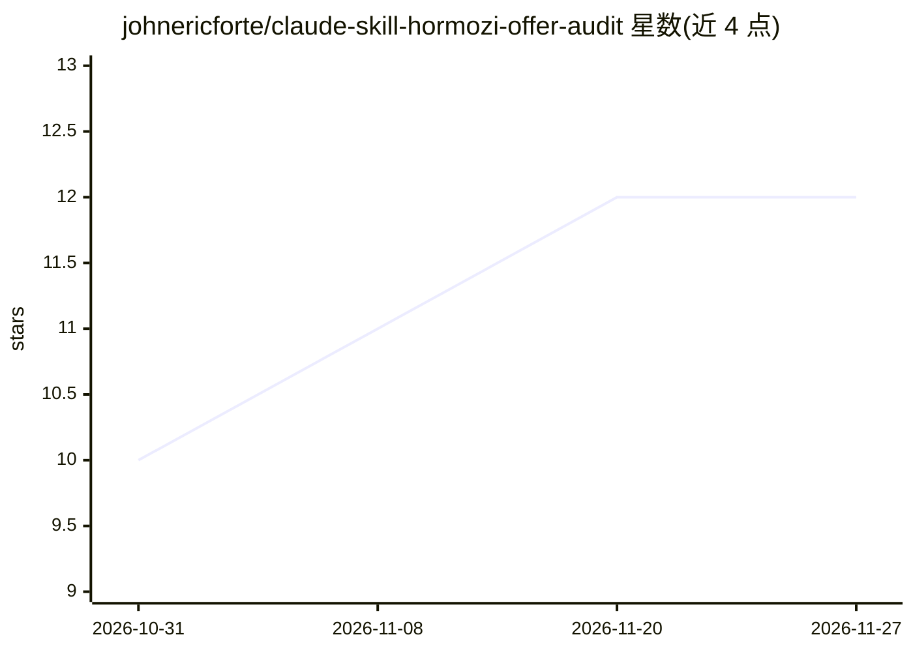

# johnericforte/claude-skill-hormozi-offer-audit

⭐ 12 · MIT · 推送 2026-05-13 · [GitHub](https://github.com/johnericforte/claude-skill-hormozi-offer-audit) · 个人维护

**基于 Hormozi 框架为营销者审计销售方案的 Claude 技能**

一个 Claude Code 技能（SKILL.md + 参考卡），对已有销售方案（落地页、定价档、lead magnet）按 $100M Offers/$100M Leads 框架做审计：四杠杆价值方程逐项打分（每项 0-25）、运行 Grand Slam 检查清单、输出 Top 3 修改建议（含 before/after 文案）。含 7 步工作流与可选 pre-audit 研究模式；只审计不生成方案；可选搭配 humanizer 技能做文案去 AI 腔处理。MIT 许可，个人开发者维护，未与 Hormozi 官方关联。

## 筛选速览

| 维度 | 判定 | 备注 |
|---|---|---|
| AI 角色 | `ai-native` | 本体是模型或模型工具 |
| 许可风险 | `permissive` | MIT |
| 部署形态 | `None` |  |
| 模型依赖 | locked-api |  |
| 硬件要求 | — | 无带数字的原话,不猜 |
| 安装摩擦 | `low` | 无编译、无系统依赖或容器化 |
| 成熟度 | — | 结构信号不足 |

## 能力要点

- Value Equation 四杠杆打分并标出最弱项，输出按影响/成本排序的 Top 3 Fixes
- 区分付费方案（Grand Slam 路径）与 lead magnet（Quality Bar 路径）
- 7 步审计工作流，含可选研究 agent 填补缺失输入
- 可选调用 humanizer 技能对修改后文案做去 AI 腔处理

## 适用场景

- SaaS 创始人在发布前重写落地页 hero 文案
- 课程创作者按价值方程给新项目定价
- 自由职业者用 Grand Slam 机制搭建服务档位
- 广告代理审计 opt-in 表现不佳的 lead magnet

## 场景标签

`AI 写作` · 领域:内容生成

## 证据(README 行号)

> L9: > A Claude skill that audits an existing sales offer (landing page, pricing tier, or lead magnet) using Alex Hormozi
> L11: You drop your landing page, your pricing tier, or your lead magnet into Claude. The skill scores the offer against 
> L86: 3. Score the Value Equation, 0-25 per lever

## 星数曲线

2026-10-31 10 → 2026-11-27 12（+2）

---
*卡片 v1 · prompt 1.4 · 生成 2026-11-18 · 置信度 high · 依据 README sha `ac88f3a2e645` · [字段定义](../../DATASET.md)*
