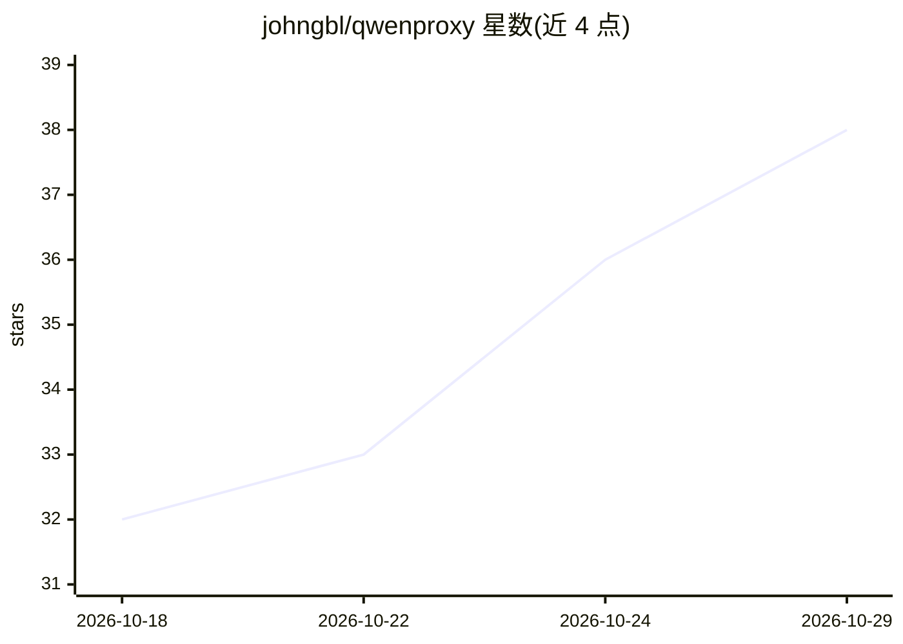

# johngbl/qwenproxy

⭐ 38 · TypeScript · ISC · 推送 2026-10-28 · [GitHub](https://github.com/johngbl/qwenproxy) · [官网](https://www.npmjs.com/package/qwenproxy-cli) · 个人维护

**将 Qwen 网页版封装为 OpenAI/Anthropic 兼容 API 的本地网关**

基于 Hono 与 Patchright 无头 Chromium 的 API 网关：把 AI 编程代理（Claude Code、Codex、OpenCode、Cursor、OMP、Zed 等）桥接到 Qwen 网页版（chat.qwen.ai），提供 /v1/chat/completions、/v1/messages、/v1/responses 等 OpenAI/Anthropic 兼容端点。机制上支持多账号轮换与配额到点切换（00:00 UTC 重置）、四种会话模式（thread/thread-temp/stateless/stateless）、图像与视频生成端点、交互式 TUI 仪表盘（qpx）与 qpx sync 一键配置各编程代理。需用户自备 Qwen 账号，通过 Chromium 会话访问网页端而非官方 API。npm 全局安装 CLI 使用。

## 筛选速览

| 维度 | 判定 | 备注 |
|---|---|---|
| AI 角色 | `ai-ecosystem` | LLM/agent 周边工具 |
| 许可风险 | `permissive` | ISC |
| 部署形态 | `library` | 以包/库形式分发 |
| 模型依赖 | — | README 未给出锁定关系 |
| 硬件要求 | — | 无带数字的原话,不猜 |
| 安装摩擦 | `low` | 无编译、无系统依赖或容器化 |
| 成熟度 | — | 结构信号不足 |

## 能力要点

- 多账号轮换、配额封顶自动切换与按需预热
- OpenAI 与 Anthropic 双协议端点，含 Responses API 持久记忆
- thread/thread-temp/stateless/stateless-temp 四种会话模式可实时切换
- qpx sync 一键配置 Claude Code/Codex/OpenCode 等编程代理并支持回滚

## 适用场景

- 让 Claude Code、Codex 等编程代理通过本地网关使用 Qwen 网页账号
- 多账号池应对 Qwen 网页版每日配额限制
- 通过 TUI 仪表盘管理账号、切换会话模式与查看指标

## 场景标签

`模型网关` `浏览器自动化` `视频生成` · 领域:Agent 开发

## 证据(README 行号)

> L7: High-performance OpenAI- and Anthropic-compatible API gateway that bridges modern AI coding agents and clients (Clau
> L28: - **Native OpenAI & Anthropic Compatibility** — `/v1/chat/completions`, `/v1/models`, `/v1/messages` (**native Anth
> L133: - **Claude Code CLI** (`~/.claude/settings.json`) — Native Anthropic protocol (`/v1/messages`).

## 星数曲线

2026-10-18 32 → 2026-10-29 38（+6）

---
*卡片 v1 · prompt 1.4 · 生成 2026-10-25 · 置信度 high · 依据 README sha `6187b66fe64d` · [字段定义](../../DATASET.md)*
