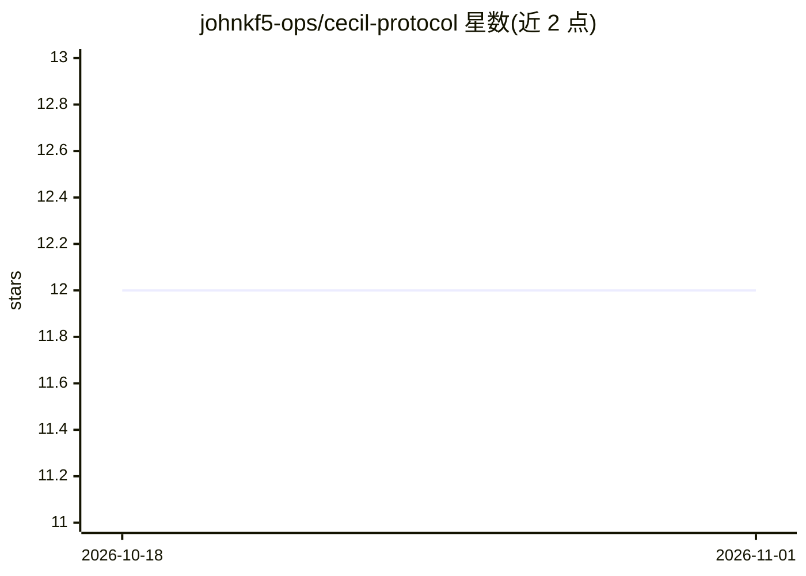

# johnkf5-ops/cecil-protocol

⭐ 12 · TypeScript · Apache-2.0 · 推送 2026-04-08 · [GitHub](https://github.com/johnkf5-ops/cecil-protocol) · 个人维护

**给 AI 助手的持久记忆层：带证据召回与可检视记忆**

Cecil 是面向 AI 助手的记忆与身份层：观察流水线将会话嵌入（Qdrant 向量库）并抽取实体、信念、未闭环承诺与矛盾，构建结构化世界模型；召回时结合 TF-IDF、语义搜索、领域匹配、证据分级与新鲜度加权。同一代码库可运行为 Web 聊天应用、Discord 机器人、REST API（11 个端点）或面向 Claude Code/Desktop 的 MCP 服务器，也可作为 SDK 供机器人/Agent 接入。要求 Node.js 22+、Docker（Qdrant）及任意 OpenAI 兼容 LLM 端点。

## 筛选速览

| 维度 | 判定 | 备注 |
|---|---|---|
| AI 角色 | `ai-ecosystem` | LLM/agent 周边工具 |
| 许可风险 | `permissive` | Apache-2.0 |
| 部署形态 | `self-host` | docker 或自建部署 |
| 模型依赖 | — | README 未给出锁定关系 |
| 硬件要求 | — | 无带数字的原话,不猜 |
| 安装摩擦 | `low` | 无编译、无系统依赖或容器化 |
| 成熟度 | — | 结构信号不足 |

## 能力要点

- 观察流水线抽取实体、信念、open loops 与矛盾，构建世界模型
- 召回排序融合 TF-IDF、语义搜索、证据分级与新鲜度加权
- 同一代码库支持 Web UI / Discord / REST API / MCP 服务器四种运行形态
- 维护流水线做去重、低质量条目退役与过时承诺检测

## 适用场景

- 给我的 Discord/Slack/Telegram 机器人加持久记忆后端
- 通过 MCP 让 Claude Code 调用 recall/store/reflect 工具
- 作为带记忆的个人助手日常对话，追踪我说过要做但未做的事
- 通过 REST API 从任意语言接入记忆与反思功能

## 场景标签

`AI 助手` `Agent 记忆` · 领域:Agent 开发

## 证据(README 行号)

> L5: Cecil is a memory layer for AI assistants. You talk to it, it remembers — not just what you said, but what you care 
> L35: **Building a bot or agent?** Use Cecil as the memory backend. One import gives your Discord bot, Slack bot, Telegra
> L37: **Using Claude Code or Claude Desktop?** Run `npm run mcp` and Cecil becomes a tool server. Ask it to recall, store

## 星数曲线

2026-10-18 12 → 2026-11-01 12（+0）

---
*卡片 v1 · prompt 1.4 · 生成 2026-11-01 · 置信度 high · 依据 README sha `a02c96c5f642` · [字段定义](../../DATASET.md)*
