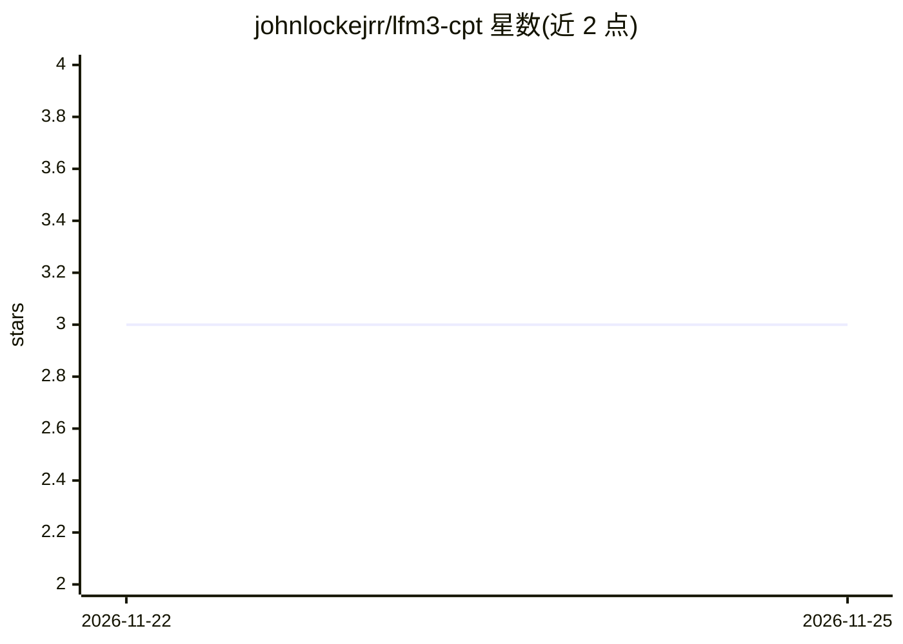

# johnlockejrr/lfm3-cpt

⭐ 3 · Python · Apache-2.0 · 推送 2026-11-22 · [GitHub](https://github.com/johnlockejrr/lfm3-cpt) · 个人维护

**面向开发者的 LFM3 模型土耳其语继续预训练 CLI 工具**

将 Liquid cookbook 的 LFM3-1.7B 继续预训练 notebook 改造为 CLI 项目：用 TRL + LoRA 在原始文本上做 CPT，含 Rich 实时训练面板、指标记录、训练前后困惑度与最小对语法评测，结束时可将适配器合并为独立检查点。可选第二阶段在土耳其语对话上做 SFT。支持 CUDA 与 ROCm 硬件配置档，配置可经 profile/TOML/--set 多层覆盖；另提供语料导出、清洗、填空基准与 101 语言最小对生成等命令。

## 筛选速览

| 维度 | 判定 | 备注 |
|---|---|---|
| AI 角色 | `ai-ecosystem` | LLM/agent 周边工具 |
| 许可风险 | `permissive` | Apache-2.0 |
| 部署形态 | `library` | 以包/库形式分发 |
| 模型依赖 | — | README 未给出锁定关系 |
| 硬件要求 | — | 无带数字的原话,不猜 |
| 安装摩擦 | `medium` | 含编译或系统依赖之一 |
| 成熟度 | — | 结构信号不足 |

## 能力要点

- TRL + LoRA 继续预训练，含 Rich 实时训练仪表盘与指标记录
- 训练前后评测：held-out/OOD 困惑度 + TurBLiMP 最小对语法测试
- 4 种硬件配置档（t4/rtx3090/strix-halo/cpu-debug），配置可多层覆盖
- 可选 SFT 第二阶段，支持多种对话数据布局自动检测

## 适用场景

- 在自有语料上对 LFM3 做语言继续预训练
- 训练后用困惑度与语法基准验证模型是否真正学到目标语言
- 为资源受限语言构建最小对评测集

## 场景标签

`微调` `模型评测` · 领域:评测与运维

## 证据(README 行号)

> L4: TRL + LoRA, turned from the Liquid cookbook notebook into a CLI project. It has a live Rich training dashboard,
> L62: |`info`|CUDA/ROCm detection, memory, bf16/TF32, library versions, suggested profile|

## 星数曲线

2026-11-22 3 → 2026-11-25 3（+0）

---
*卡片 v1 · prompt 1.4 · 生成 2026-11-22 · 置信度 high · 依据 README sha `c8dad1367884` · [字段定义](../../DATASET.md)*
