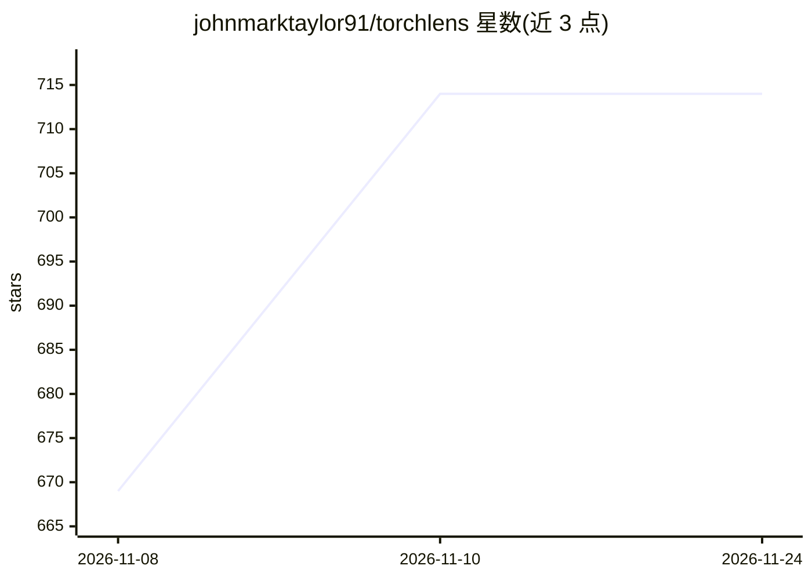

# johnmarktaylor91/torchlens

⭐ 714 · Python · Apache-2.0 · 推送 2026-11-17 · [GitHub](https://github.com/johnmarktaylor91/torchlens) · 个人维护

**神经网络内部观测库：捕获任意模型的激活、梯度与计算图**

面向 PyTorch 研究者的模型内部检查、可视化与干预工具：一个 tl.trace 调用即可记录前向过程中每个运算的激活与梯度，无需 hooks 或修改模型代码，支持含循环、条件分支的动态模型。提供按函数/模块/因果影响选择单元的选择器语法、基于 do-calculus 的干预（消融、steering、激活 patch）、多 trace 对比（Bundle）、20+ 调试函数（定位 NaN、死单元、梯度健康）以及可自定义的计算图可视化，含 800+ 元数据字段并可导出 pandas。首条 trace 开销约为普通前向的数倍，可用 record/extract 等更快路径。描述另称支持 JAX、TensorFlow 等框架并在 6400+ 模型上验证。

## 筛选速览

| 维度 | 判定 | 备注 |
|---|---|---|
| AI 角色 | `ai-ecosystem` | LLM/agent 周边工具 |
| 许可风险 | `permissive` | Apache-2.0 |
| 部署形态 | `library` | 以包/库形式分发 |
| 模型依赖 | — | README 未给出锁定关系 |
| 硬件要求 | — | 无带数字的原话,不猜 |
| 安装摩擦 | `low` | 无编译、无系统依赖或容器化 |
| 成熟度 | — | 结构信号不足 |

## 能力要点

- tl.trace 一次调用记录每个运算的激活与梯度，无需 hooks 或改代码
- 基于 do-calculus 语法的干预：消融、steering、跨运行激活 patch（20+ 内置编辑）
- 按函数、模块地址、感受野/投射野等因果条件选择任意单元集合
- 计算图可视化与 20+ 调试函数（找 NaN、死单元、梯度爆炸、推断输入形状）

## 适用场景

- 做 mechanistic interpretability 实验时提取和编辑中间激活
- 对比 clean 与 patched 运行，定位干预影响最大的运算
- 调试动态模型（循环/条件分支/MoE）中的 NaN 与梯度问题

## 场景标签

`LLM 可观测性` · 领域:评测与运维

## 证据(README 行号)

> L28: Other aspects are just plumbing, and while tedious, they are finite: the same small set of tasks for every model, l

## 星数曲线

2026-11-08 669 → 2026-11-24 714（+45）

---
*卡片 v1 · prompt 1.4 · 生成 2026-11-17 · 置信度 high · 依据 README sha `3cb0af28494a` · [字段定义](../../DATASET.md)*
