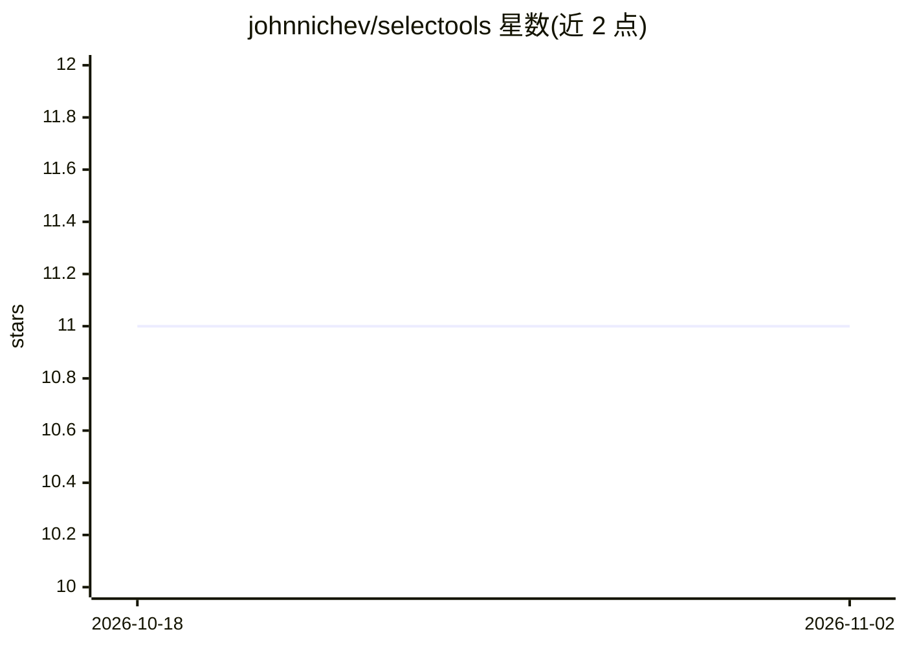

# johnnichev/selectools

⭐ 11 · Python · Apache-2.0 · 推送 2026-10-15 · [GitHub](https://github.com/johnnichev/selectools) · [官网](https://selectools.dev) · 组织维护

**Python 多智能体编排框架：管道组合、护栏、审计与成本追踪**

以纯 Python 构建智能体图并用 `|` 组合管道的多智能体编排框架，无 DSL、无编译步骤。支持 OpenAI、Anthropic、Gemini、Ollama 等提供商，内置四阶段护栏（输入/工具参数/工具结果）、审计日志（JSONL）、成本追踪（含缓存输入费率）、混合 RAG、结构化输出与流式契约、六种会话后端（JSON/Redis/Mongo/DynamoDB 等）、定时调度与 56 个工具箱工具。1.0 版本公共 API 冻结，`@stable` 符号承诺跨两个次版本兼容；要求 Python 3.10+。

## 筛选速览

| 维度 | 判定 | 备注 |
|---|---|---|
| AI 角色 | `ai-ecosystem` | LLM/agent 周边工具 |
| 许可风险 | `permissive` | Apache-2.0 |
| 部署形态 | `library` | 以包/库形式分发 |
| 模型依赖 | local-ok | 支持本地模型 |
| 硬件要求 | — | 无带数字的原话,不猜 |
| 安装摩擦 | `low` | 无编译、无系统依赖或容器化 |
| 成熟度 | — | 结构信号不足 |

## 能力要点

- 纯 Python 多智能体编排，`|` 管道组合，一条命令部署
- 四阶段护栏（输入/工具参数/工具结果）含提示注入防护与 SSRF 校验
- 审计日志 JSONL 记录、成本追踪与缓存输入费率计算
- 结构化输出的原生 JSON-schema 约束与已测试的流式公共契约

## 适用场景

- 用纯 Python 构建和编排带护栏的多智能体工作流
- 企业场景中对工具调用参数与外部 API 响应做门控和审计
- 跨 OpenAI/Anthropic/Gemini/Ollama 等提供商部署智能体并追踪成本

## 场景标签

`Agent 框架` `多智能体` `LLM 可观测性` · 领域:Agent 开发

## 证据(README 行号)

> L17: **Multi-agent orchestration in plain Python.** Build agent graphs, compose pipelines with `|`, deploy with one comm
> L66: - **Frozen, marked surface** — every public symbol carries a `@stable`/`@beta` marker (CI-enforced). The stable set

## 星数曲线

2026-10-18 11 → 2026-11-02 11（+0）

---
*卡片 v1 · prompt 1.4 · 生成 2026-11-02 · 置信度 high · 依据 README sha `f0e9cfc22ad9` · [字段定义](../../DATASET.md)*
