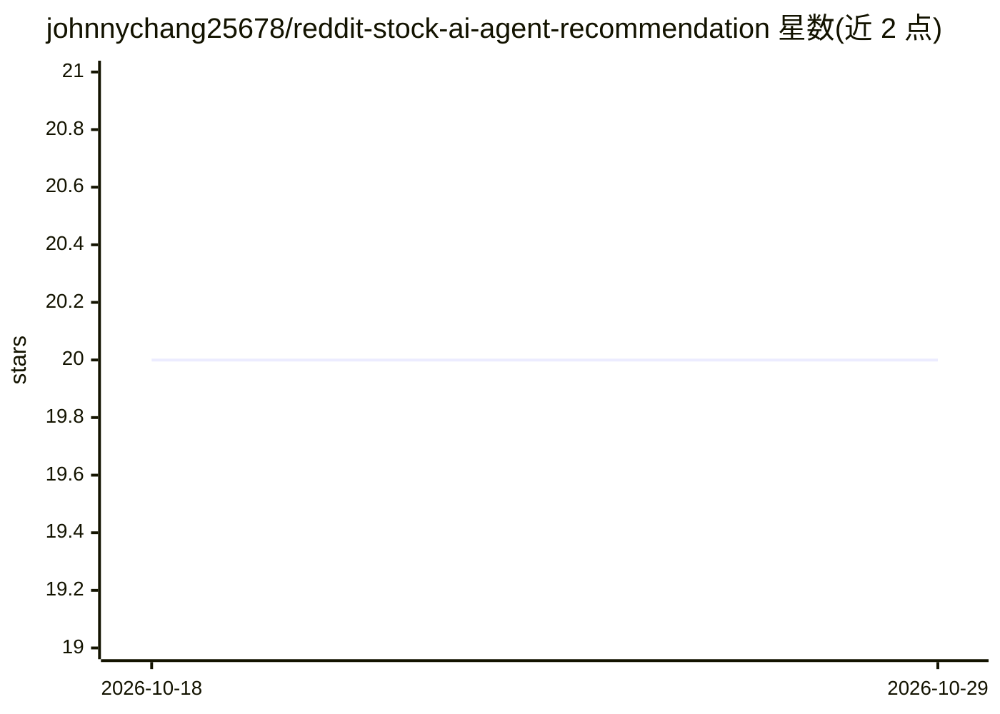

# johnnychang25678/reddit-stock-ai-agent-recommendation

⭐ 20 · Python · MIT · 推送 2026-04-01 · [GitHub](https://github.com/johnnychang25678/reddit-stock-ai-agent-recommendation) · 个人维护

**AI agent 分析 Reddit 帖子并生成每周股票买入推荐与模拟交易**

基于 GitHub Actions 运行的三工作流系统：每周抓取 r/wallstreetbets 帖子，由 News/DD/YOLO 三个专项 AI agent 结合实时网络搜索分析，再由 Stock Picker Agent 选出 1-3 只高置信度股票；交易决策 agent 对虚拟组合做买卖决策，每日 cron 跟踪组合表现，结果发送到 Discord。使用 PostgreSQL（Supabase）持久化状态以保证幂等执行。README 声明推荐不构成投资建议。作者自研工作流引擎与 agent 框架，希望可复用于其他场景。

## 筛选速览

| 维度 | 判定 | 备注 |
|---|---|---|
| AI 角色 | `ai-native` | 本体是模型或模型工具 |
| 许可风险 | `permissive` | MIT |
| 部署形态 | `None` |  |
| 模型依赖 | — | README 未给出锁定关系 |
| 硬件要求 | — | 无带数字的原话,不猜 |
| 安装摩擦 | `low` | 无编译、无系统依赖或容器化 |
| 成熟度 | — | 结构信号不足 |

## 能力要点

- News/DD/YOLO 三个专项 agent 结合实时网络搜索验证信息
- Stock Picker Agent 筛选 1-3 只高置信度推荐
- 交易 agent 对虚拟组合做买卖决策（Yahoo Finance 价格模拟）
- PostgreSQL 持久化支持幂等工作流与多 agent 并行执行

## 适用场景

- 在 Discord 频道接收每周股票推荐与组合表现更新
- 观察 AI agent 流水线如何做信息验证与投资决策
- 把工作流引擎和 agent 框架适配到其他分析场景

## 场景标签

`金融量化` `多智能体` `Agent 框架` · 领域:Agent 开发

## 证据(README 行号)

> L4: - Scrapes Reddit's `r/wallstreetbets`, analyzes posts using AI agents, and generates a list of stock BUY recommendat
> L22: 1. **Reddit Stock Recommendation Workflow**: Runs weekly to scrape Reddit posts, analyze them with AI agents, gener

## 星数曲线

2026-10-18 20 → 2026-10-29 20（+0）

---
*卡片 v1 · prompt 1.4 · 生成 2026-10-28 · 置信度 high · 依据 README sha `d59d890128ff` · [字段定义](../../DATASET.md)*
