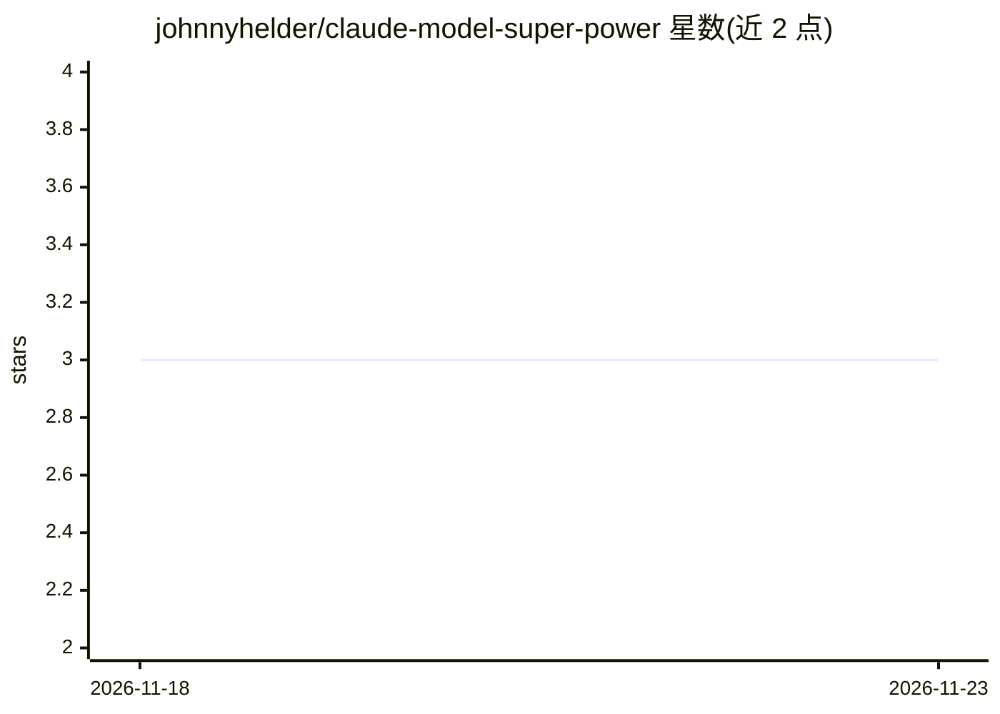

# johnnyhelder/claude-model-super-power

⭐ 3 · TypeScript · MIT · 推送 2026-10-30 · [GitHub](https://github.com/johnnyhelder/claude-model-super-power) · [官网](https://www.johnnyhelder.com) · 个人维护

**为 Claude Code 做模型路由的 mod：任务分派给合适模型**

以 Claude Code 插件（plugin marketplace 安装）形式运行的模型路由 mod：主对话模型保持不变并充当指挥，将搜索/读取委托给 Haiku（batedor）、执行类任务给 Sonnet（executor）、第二意见给 Sonnet 4.6、审查给 Opus（revisor）、高成本决策给 Fable（arquiteto）。自 1.1.0 起在交互会话中注入 system prompt 强制委派（aviso/forte/desligado 三种模式），并提供 /super-power 命令查看各模型用量与按 API 价格估算的成本。子代理被禁止读取 .env、SSH 密钥、云凭据等受保护文件。无网络、无遥测。

## 筛选速览

| 维度 | 判定 | 备注 |
|---|---|---|
| AI 角色 | `ai-ecosystem` | LLM/agent 周边工具 |
| 许可风险 | `permissive` | MIT |
| 部署形态 | `library` | 以包/库形式分发 |
| 模型依赖 | — | README 未给出锁定关系 |
| 硬件要求 | — | 无带数字的原话,不猜 |
| 安装摩擦 | `low` | 无编译、无系统依赖或容器化 |
| 成熟度 | — | 结构信号不足 |

## 能力要点

- 按任务类型将子代理路由到 Haiku/Sonnet/Opus/Fable 等模型
- /super-power 命令显示会话与每周的分模型用量及成本估算
- 强制指挥机制：3 种严格模式提醒或拒绝连续直接读取
- 子代理访问受保护文件（.env、SSH 密钥、云凭据等）的封锁机制

## 适用场景

- 让 Claude Code 会话中的搜索、执行、审查任务分别用不同模型
- 查看每次会话各模型消耗的 token 与估算成本
- 阻止子代理读取项目中的密钥与凭据文件

## 场景标签

`模型网关` · 领域:Agent 开发

## 证据(README 行号)

> L3: **Um maestro para o Claude Code.** Cada tarefa vai para o modelo certo, e você vê quanto cada um trabalhou.
> L5: O Claude Code usa o mesmo modelo caro para tudo, até para procurar um arquivo. É como pôr o camisa 10 para carregar 
> L98: /plugin install model-super-power --marketplace johnnyhelder/claude-model-super-power

## 星数曲线

2026-11-18 3 → 2026-11-23 3（+0）

---
*卡片 v1 · prompt 1.4 · 生成 2026-11-21 · 置信度 mid · 依据 README sha `9281dc378d0c` · [字段定义](../../DATASET.md)*
