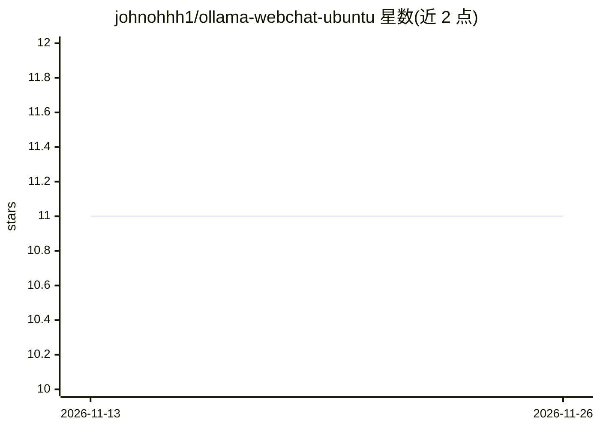

# johnohhh1/ollama-webchat-ubuntu

⭐ 11 · Go · MIT · 推送 2026-11-13 · [GitHub](https://github.com/johnohhh1/ollama-webchat-ubuntu) · 个人维护

**为 Linux 用户提供官方 Ollama 桌面应用的 GTK 原生移植**

将官方 Ollama 桌面应用（仅发布 Windows/macOS 二进制）移植到 Linux 的 GTK3 + WebKit2GTK 桌面应用，Wayland 原生、带系统托盘与单实例锁。提供模型选择、文件附件、聊天历史（SQLite）等完整聊天界面；连接既有的 localhost:11434 Ollama 服务，不启动或管理其守护进程。另含可选的本地图像生成组件（Python + PyTorch + diffusers，systemd 服务，需 NVIDIA GPU）。在 Ubuntu 26.04 / GNOME 50 上测试。

## 筛选速览

| 维度 | 判定 | 备注 |
|---|---|---|
| AI 角色 | `ai-ecosystem` | LLM/agent 周边工具 |
| 许可风险 | `permissive` | MIT |
| 部署形态 | `None` |  |
| 模型依赖 | local-ok | 支持本地模型 |
| 硬件要求 | — | 无带数字的原话,不猜 |
| 安装摩擦 | `low` | 无编译、无系统依赖或容器化 |
| 成熟度 | — | 结构信号不足 |

## 能力要点

- GTK3 + WebKit2GTK 渲染 Ollama React 前端，Wayland 原生无需 XWayland
- 系统托盘、单实例锁与旧版聊天历史（~/.ollama/db.sqlite）自动迁移
- 可选本地图像生成：Python 服务运行 Z-Image-Turbo / FLUX.2-klein，模型经 Hugging Face 下载
- 通过修改约 40 个 Go 文件的 build tag 与 CGo 标志实现 Linux 编译

## 适用场景

- 在 Ubuntu/Wayland 桌面环境使用 Ollama 图形聊天界面
- 本地管理聊天历史并直接与既有 Ollama 服务配合使用
- 在 NVIDIA GPU 上从聊天界面生成本地图像

## 场景标签

`聊天机器人` `图像生成` · 领域:对话与助手

## 证据(README 行号)

> L5: **Native GTK3 + WebKit2GTK desktop app for Ollama on Linux.**
> L26: - Talks to your existing Ollama service at `localhost:11434` — does **not** start or manage the Ollama daemon

## 星数曲线

2026-11-13 11 → 2026-11-26 11（+0）

---
*卡片 v1 · prompt 1.4 · 生成 2026-11-18 · 置信度 high · 依据 README sha `bf32034552de` · [字段定义](../../DATASET.md)*
