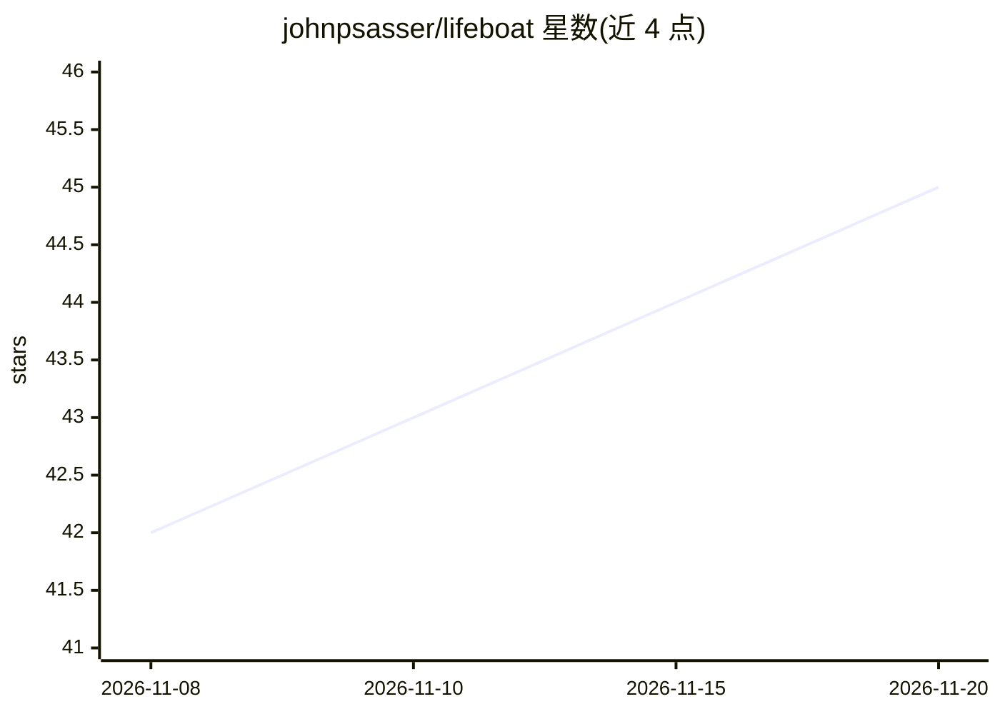

# johnpsasser/lifeboat

⭐ 45 · Python · MIT · 推送 2026-11-03 · [GitHub](https://github.com/johnpsasser/lifeboat) · 个人维护

**断网应急问答助手：本地 LLM + 200GB 离线资料库，附引用来源**

面向个人/家庭应急准备的离线 AI 问答系统：在有网时一次性下载约 200 GB 资料库（医学手册、美军野战手册、生存/维修/农业指南、英文维基百科 ZIM 归档及约 80 份 PDF），建立 SQLite 检索索引；断网后在一台 Apple Silicon Mac 上通过 llama.cpp 运行本地对话模型（Qwen 3.6/3.8、Gemma 4 三档配置），对急救、发电机、净水等实际问题给出带 [n] 引用的分步回答。机制上采用 BM25 关键词 + 向量语义混合检索、bge-reranker 重排取 8 段，并在代码层设儿童剂量检查。限制：仅支持 Apple Silicon，需 16–64 GB 内存与约 40–170 GB 磁盘；作者声明它是辅助而非权威。

## 筛选速览

| 维度 | 判定 | 备注 |
|---|---|---|
| AI 角色 | `ai-native` | 本体是模型或模型工具 |
| 许可风险 | `permissive` | MIT |
| 部署形态 | `self-host` | docker 或自建部署 |
| 模型依赖 | local-ok | 支持本地模型 |
| 硬件要求 | — | 无带数字的原话,不猜 |
| 安装摩擦 | `low` | 无编译、无系统依赖或容器化 |
| 成熟度 | — | 结构信号不足 |

## 能力要点

- 完全离线运行：模型（llama.cpp/Metal）+ SQLite 检索索引 + 约 200 GB 资料库均在一台 Mac 上，verify-offline 命令验证无网络调用
- 每条回答带 [n] 引用并可跳转原文段落，模型被要求来源未覆盖时明说而非猜测
- 三档模型配置（battery/best/tiny），tiny 可在 16 GB 内存 Mac 上运行，无模型时仍可纯库检索
- 家庭档案（年龄/体重/药物过敏）与地区危险信息感知；可打印约 50 个关键流程的纸质备份

## 适用场景

- 灾害/断网时在没有互联网的 Mac 上查询急救、净水、发电、维修等应急知识
- 为家庭预置一套含儿童剂量警示的可引用医学参考资料
- 离线查阅全量英文维基百科与生存/维修类手册

## 场景标签

`文档问答` · 领域:知识与检索

## 证据(README 行号)

> L19: Lifeboat is a self-contained emergency reference you set up while you still have the internet. It
> L21: To answer, it searches a large offline library and has a local language model write a short, cited
> L26: - **A chat model** (Qwen 3.6 or 3.8, or Gemma 4 for low power) runs in llama.cpp on the GPU.

## 星数曲线

2026-11-08 42 → 2026-11-20 45（+3）

---
*卡片 v1 · prompt 1.4 · 生成 2026-11-18 · 置信度 mid · 依据 README sha `0ac02316908c` · [字段定义](../../DATASET.md)*
