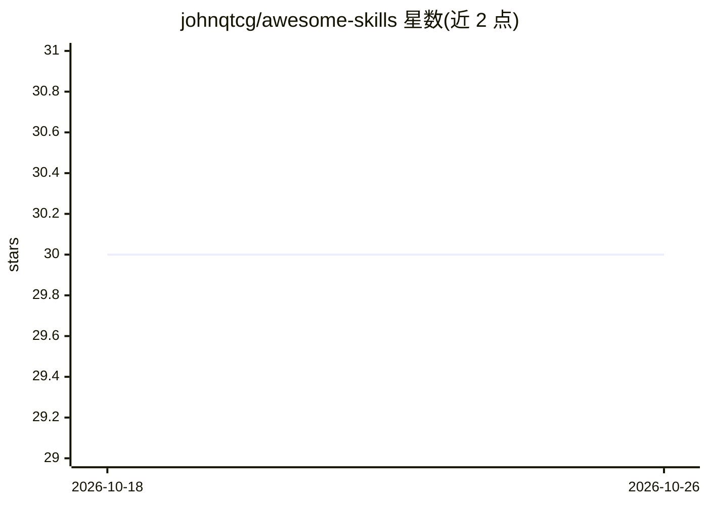

# johnqtcg/awesome-skills

⭐ 30 · Python · MIT · 推送 2026-10-09 · [GitHub](https://github.com/johnqtcg/awesome-skills) · [官网](https://johnqtcg.github.io/awesome-skills/) · 个人维护 · 中文 README

**面向 Claude Code 的生产级 AI 技能策展库：51 个技能+评估与测试**

一个 AI 技能工程化策展项目：收录 51 个可安装的 Claude Code 技能（覆盖 Go、测试、安全、CI/CD、数据库、文档等），其中 16 个为多 agent 组件（9 部分代码评审系统与 7 部分美股分析系统）。配套 48 份中英双语设计理由文档、64 份量化评估报告、376 个黄金测试夹具与 93 个 Python 测试文件做确定性回归。技能通过 npx skills CLI 安装，兼容 Cursor、GitHub Copilot 等 15+ agent；后端技能可串联为从编码到合并的质量流水线。方法论文档语言与平台无关，可复用于其他项目。

## 筛选速览

| 维度 | 判定 | 备注 |
|---|---|---|
| AI 角色 | `ai-knowledge` | 知识聚合/清单类 |
| 许可风险 | `permissive` | MIT |
| 部署形态 | `library` | 以包/库形式分发 |
| 模型依赖 | — | README 未给出锁定关系 |
| 硬件要求 | — | 无带数字的原话,不猜 |
| 安装摩擦 | `low` | 无编译、无系统依赖或容器化 |
| 成熟度 | — | 结构信号不足 |

## 能力要点

- 51 个可安装技能，16 个多 agent 编排组件（Go 评审 9 件套、美股分析 7 件套）
- 五层可追溯结构：bestpractice→rationale→skills→evaluate→outputexample
- 376 个黄金测试夹具 + 93 个 Python 测试文件做确定性回归，不依赖 LLM 评审 LLM
- 64 份中英双语量化评估报告（触发准确率/任务表现/token 成本三维度）

## 适用场景

- 为 Claude Code 或其他 AI 编码助手查找生产级技能
- 学习高质量 skill 的设计方法论与量化评估方法
- 用后端技能流水线串联编码、测试、提交、PR、评审全流程

## 场景标签

`精选清单` `多智能体` `代码审查` · 领域:Agent 开发

## 证据(README 行号)

> L9: A curated system for **AI skill engineering** — not just a prompt collection. Built for Claude Code and applicable t
> L11: - **51** installable Claude Code skills spanning Go, testing, security, CI/CD, database, cache, infrastructure, res
> L23: Works with Claude Code, Cursor, GitHub Copilot, and 15+ other agents:

## 星数曲线

2026-10-18 30 → 2026-10-26 30（+0）

---
*卡片 v1 · prompt 1.4 · 生成 2026-10-26 · 置信度 high · 依据 README sha `b53490136a21` · [字段定义](../../DATASET.md)*
