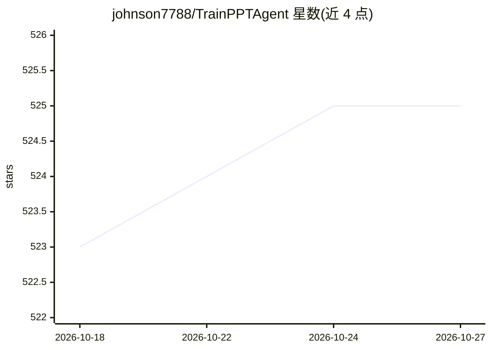

# johnson7788/TrainPPTAgent

⭐ 525 · Vue · Apache-2.0 · 推送 2026-10-14 · [GitHub](https://github.com/johnson7788/TrainPPTAgent) · 个人维护 · 中文 README

**输入主题自动生成套用模板的 PPT 的 AI 应用**

前后端分离的演示文稿生成系统：用户输入主题后经微信联网搜索收集资料，由 LLM 生成 Markdown 大纲，再结合所选模板流式逐页生成 PPT 内容并实时渲染；支持知识库上传与图表。后端为 Python (FastAPI)，采用 A2A/ADK/MCP 搜索，训练侧引入 GRPO 强化学习优化生成效果（训练代码在另一仓库）。支持商业与本地模型配置，提供一键启动脚本与 docker compose 部署；需自备 API 密钥并分别配置各服务的 .env。前端基于 PPTist（AGPL-3）。

## 筛选速览

| 维度 | 判定 | 备注 |
|---|---|---|
| AI 角色 | `ai-native` | 本体是模型或模型工具 |
| 许可风险 | `permissive` | Apache-2.0 |
| 部署形态 | `self-host` | docker 或自建部署 |
| 模型依赖 | — | README 未给出锁定关系 |
| 硬件要求 | — | 无带数字的原话,不猜 |
| 安装摩擦 | `low` | 无编译、无系统依赖或容器化 |
| 成熟度 | — | 结构信号不足 |

## 能力要点

- 主题→联网搜索→大纲→逐页内容的自动生成流程
- 多模板选择与内容样式分离式填充，支持图表
- 支持商业模型与本地模型配置
- 一键启动脚本与 docker compose 部署

## 适用场景

- 输入主题快速产出结构完整的演示文稿
- 将已有大纲或文件上传知识库后生成 PPT
- 选择模板套用样式并逐页实时生成内容

## 场景标签

`AI 写作` · 领域:内容生成

## 证据(README 行号)

> L3: **TrainPPTAgent** 是一款基于 AI 的智能演示文稿生成工具。用户只需输入主题，系统即可自动通过微信搜索网络内容，生成结构完整、内容丰富的 PPT 大纲与逐页内容。项目采用 **前后端分离架构**：前端负责交互、大纲
> L169: 1. **输入主题** → 用户在前端输入主题

## 星数曲线

2026-10-18 523 → 2026-10-27 525（+2）

---
*卡片 v1 · prompt 1.4 · 生成 2026-10-21 · 置信度 high · 依据 README sha `49fb6319181e` · [字段定义](../../DATASET.md)*
