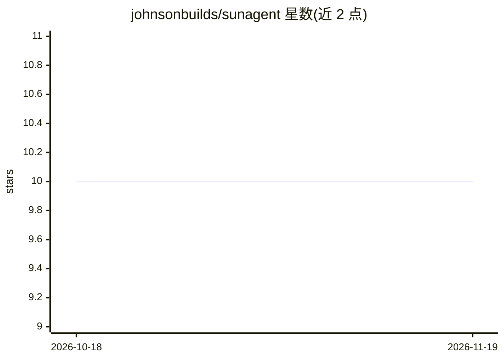

# johnsonbuilds/sunagent

⭐ 10 · Shell · Apache-2.0 · 推送 2026-11-18 · [GitHub](https://github.com/johnsonbuilds/sunagent) · [官网](https://getclawcloud.com/sunagent) · 个人维护

**面向开发者的可模块化实验 AI Agent 运行时**

从零构建的 provider 无关 Agent 运行时：引擎（循环、追踪、事件、执行器）保持稳定，影响行为的部分（prompt、工具、限制、上下文、恢复、验证）以 YAML harness manifest 形式版本化。支持任意 OpenAI 兼容 Chat Completions 端点，带 streaming 与 reasoning replay；提供 CLI 与 Next.js/FastAPI 的 Web UI，通过 Harbor 适配器接入 terminal-bench、swe-bench 基准评测，trace 记录到 JSONL。需 Python 3.12+ 与 uv，Apache 2.0 许可。

## 筛选速览

| 维度 | 判定 | 备注 |
|---|---|---|
| AI 角色 | `ai-ecosystem` | LLM/agent 周边工具 |
| 许可风险 | `permissive` | Apache-2.0 |
| 部署形态 | `library` | 以包/库形式分发 |
| 模型依赖 | — | README 未给出锁定关系 |
| 硬件要求 | — | 无带数字的原话,不猜 |
| 安装摩擦 | `low` | 无编译、无系统依赖或容器化 |
| 成熟度 | — | 结构信号不足 |

## 能力要点

- harness 基因（prompt/tools/context 等 7 项）以 YAML 版本化并支持派生与血缘追溯
- Schema 校验的工具调用与上下文窗口硬门槛
- RunTrace/EventEmitter 双事件流与基准评测（Harbor 适配）
- CLI 与浏览器 Web UI 共享同一运行时

## 适用场景

- 实验并对比不同 harness 配置对 Agent 任务得分的影响
- 通过 Harbor 在 terminal-bench 等基准上运行与归档评测
- 本地部署带 Web UI 的工具调用 Agent 并留存可追溯 trace

## 场景标签

`Agent 框架` `模型评测` `编码 Agent` · 领域:Agent 开发

## 证据(README 行号)

> L5: SunAgent is a modular, provider-agnostic runtime for tool-calling agents. The engine (loop, tracing, events, executo
> L14: - CLI and browser UI over the same runtime; Harbor adapters for benchmarks

## 星数曲线

2026-10-18 10 → 2026-11-19 10（+0）

---
*卡片 v1 · prompt 1.4 · 生成 2026-11-19 · 置信度 high · 依据 README sha `176484792ed0` · [字段定义](../../DATASET.md)*
