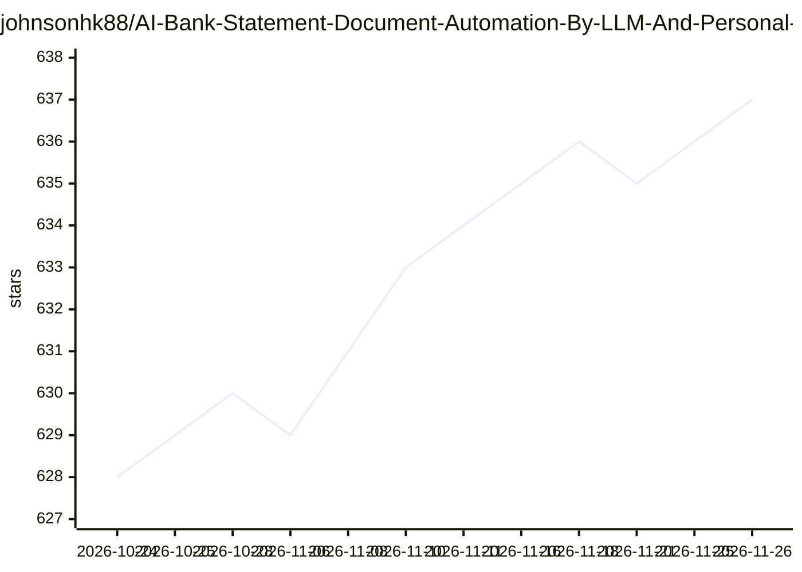

# johnsonhk88/AI-Bank-Statement-Document-Automation-By-LLM-And-Personal-Finanical-Analysis-Prediction

⭐ 637 · Jupyter Notebook · Apache-2.0 · 推送 2026-11-07 · [GitHub](https://github.com/johnsonhk88/AI-Bank-Statement-Document-Automation-By-LLM-And-Personal-Finanical-Analysis-Prediction) · 个人维护

**用 LLM+OCR 从银行对账单 PDF 提取并做财务分析的应用**

BankAI 是一个面向个人银行对账单的文档自动化系统：PDF 经 YOLO 版面检测、OCR 与 LLM 表格提取后结构化，再做收支分类、趋势分析与自然语言问答；嵌入前先做 PII 脱敏并存入 Qdrant/Chroma 向量库。支持 CrewAI、Deep Agents、Hermes 三套并行 agent 框架，LLM 通过 LiteLLM 接入本地推理引擎（vLLM/SGLang/LM Studio/Ollama 等，需自备引擎，应用本身不启动 GPU 引擎）。提供 FastAPI+PostgreSQL+React 全栈形态与 Jupyter 实验路径，另带 Prometheus/Grafana GPU 监控与 MLflow 追踪。

## 筛选速览

| 维度 | 判定 | 备注 |
|---|---|---|
| AI 角色 | `ai-native` | 本体是模型或模型工具 |
| 许可风险 | `permissive` | Apache-2.0 |
| 部署形态 | `self-host` | docker 或自建部署 |
| 模型依赖 | local-ok | 支持本地模型 |
| 硬件要求 | — | 无带数字的原话,不猜 |
| 安装摩擦 | `low` | 无编译、无系统依赖或容器化 |
| 成熟度 | — | 结构信号不足 |

## 能力要点

- YOLO 版面检测 + OCR + LLM 表格提取的 PDF 解析管线
- CrewAI / Deep Agents / Hermes 三套并行 agent harness
- 通过 LiteLLM 接入本地 LLM 引擎，前端从 /v1/models 动态选取模型
- PII 先脱敏再嵌入向量库的安全 RAG 管线

## 适用场景

- 把 PDF 银行对账单批量转成结构化财务数据
- 对个人账单做收支分类与季度/年度趋势报表
- 用自然语言查询自己的流水记录

## 场景标签

`文档解析` `OCR` `文档问答` `数据分析` · 领域:效率与自动化

## 证据(README 行号)

> L10: > **Intelligent document automation for bank statements** — Extract, structure, analyze, and query financial data f
> L17: - **Local LLM First** — vLLM, SGLang, Strata, LM Studio, Ollama via LiteLLM; frontend picks a live `/v1/models` lis
> L31: BankAI does not start the GPU engine. Run one of these, then select it in **New analysis**:

## 星数曲线

2026-10-24 628 → 2026-11-26 637（+9）

---
*卡片 v1 · prompt 1.4 · 生成 2026-11-24 · 置信度 high · 依据 README sha `23987657bec7` · [字段定义](../../DATASET.md)*
