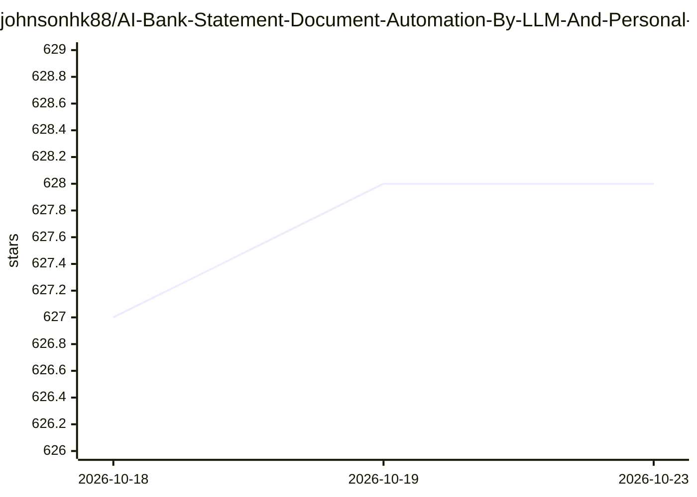

# johnsonhk88/AI-Bank-Statement-Document-Automation-By-LLM-And-Personal-Finanical-Analysis-Prediction

⭐ 628 · Jupyter Notebook · Apache-2.0 · 推送 2026-08-02 · [GitHub](https://github.com/johnsonhk88/AI-Bank-Statement-Document-Automation-By-LLM-And-Personal-Finanical-Analysis-Prediction) · 个人维护

**银行对账单 PDF 自动化处理与个人财务分析系统**

用 YOLO 版面检测 + OCR + LLM 从银行对账单 PDF 中抽取、结构化并分析财务数据，支持自然语言查询。提供三套并行 agent 框架（CrewAI 基线、LangChain Deep Agents、Docker 沙箱 Hermes），本地模型优先：经 LiteLLM 接入 LM Studio / Ollama，推荐 9B+ 参数、16K+ 上下文模型。含 PII 先脱敏再嵌入的 RAG 流水线（Qdrant/Chroma），以及 FastAPI + PostgreSQL + Celery + React 的全栈应用。限制：小模型 JSON 输出常失败，建议 Markdown 报告；全栈部署需 Docker 与较新 NVIDIA 驱动（GPU 可选）。

## 筛选速览

| 维度 | 判定 | 备注 |
|---|---|---|
| AI 角色 | `ai-native` | 本体是模型或模型工具 |
| 许可风险 | `permissive` | Apache-2.0 |
| 部署形态 | `self-host` | docker 或自建部署 |
| 模型依赖 | local-ok | 支持本地模型 |
| 硬件要求 | — | 无带数字的原话,不猜 |
| 安装摩擦 | `low` | 无编译、无系统依赖或容器化 |
| 成熟度 | — | 结构信号不足 |

## 能力要点

- YOLO 版面检测 + OCR + LLM 表格抽取
- CrewAI / Deep Agents / Hermes 三套并行 agent 框架
- 本地 LLM 优先：LM Studio / Ollama 经 LiteLLM 异步调用
- PII 先脱敏再入向量库的 RAG 流水线（Qdrant/Chroma）

## 适用场景

- 把银行对账单 PDF 转成结构化财务数据
- 对个人收支做分类与趋势分析并用自然语言查询
- 在本地模型上跑完整文档处理流水线，避免数据外发

## 场景标签

`OCR` `RAG` `文档解析` · 领域:知识与检索

## 证据(README 行号)

> L14: - **Advanced PDF Parsing** — YOLO layout detection + OCR + LLM-based table extraction
> L20: - **Financial Intelligence** — Income/expense categorization, trend analysis, natural language querying
> L39: |**LLM Orchestration**|LiteLLM (LM Studio, Ollama, OpenAI, DeepSeek, etc.)|

## 星数曲线

2026-10-18 627 → 2026-10-23 628（+1）

---
*卡片 v1 · prompt 1.4 · 生成 2026-10-21 · 置信度 mid · 依据 README sha `6cbdfd66d057` · [字段定义](../../DATASET.md)*
