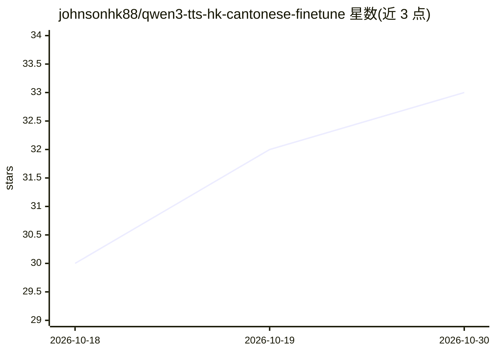

# johnsonhk88/qwen3-tts-hk-cantonese-finetune

⭐ 33 · Jupyter Notebook · 推送 2026-08-02 · [GitHub](https://github.com/johnsonhk88/qwen3-tts-hk-cantonese-finetune) · 个人维护 · 中文 README

**面向香港粤语的 Qwen3-TTS 微调工作流：克隆与多说话人语音生成**

提供将 Qwen3-TTS（0.6B/1.7B-Base）微调为香港粤语语音的完整工作流：数据准备（过滤 5–30 秒单声道 WAV、自动说话人聚类分配 speaker_id）、单/多说话人 LoRA 或全量微调脚本、MLflow 实验跟踪、Voice Clone Server（Web UI/API 推理）以及模型评估（WER/CER、说话人相似度 ECAPA-TDNN、UTMOS）。LoRA 路径面向 8–12 GB 显存 GPU，需 NVIDIA CUDA 12.x 与约 25 GB 磁盘。限制：多说话人训练要求每行数据含 speaker_id；基础模型已有较强中文支持，微调主要用于方言/口音适配。

## 筛选速览

| 维度 | 判定 | 备注 |
|---|---|---|
| AI 角色 | `ai-ecosystem` | LLM/agent 周边工具 |
| 许可风险 | `permissive` | — |
| 部署形态 | `library` | 以包/库形式分发 |
| 模型依赖 | — | README 未给出锁定关系 |
| 硬件要求 | — | 无带数字的原话,不猜 |
| 安装摩擦 | `medium` | 含编译或系统依赖之一 |
| 成熟度 | — | 结构信号不足 |

## 能力要点

- 单说话人声音克隆与多说话人 LoRA 导出（一个检查点多 speaker_id 槽位）
- 自动说话人聚类脚本生成 speaker_id 与匹配 ref_audio
- Voice Clone Server 提供 Web UI / API 即时推理
- 评估脚本计算 WER/CER（支持中英混说）、说话人相似度与 UTMOS

## 适用场景

- 用自有粤语语料微调 Qwen3-TTS 得到带本地口音的语音模型
- 多说话人数据集训练一个支持多音色的 TTS 检查点
- 对比微调前后模型的识别错误率与音质指标

## 场景标签

`语音合成` `微调` · 领域:内容生成

## 证据(README 行号)

> L3: This repository provides a **complete workflow** for fine-tuning **Qwen3-TTS** (0.6B-Base or 1.7B-Base) to generate 
> L10: - **LoRA fine-tuning** (recommended for 8–12 GB GPUs)
> L14: - Training with **MLflow** experiment tracking

## 星数曲线

2026-10-18 30 → 2026-10-30 33（+3）

---
*卡片 v1 · prompt 1.4 · 生成 2026-10-26 · 置信度 mid · 依据 README sha `b90338865696` · [字段定义](../../DATASET.md)*
