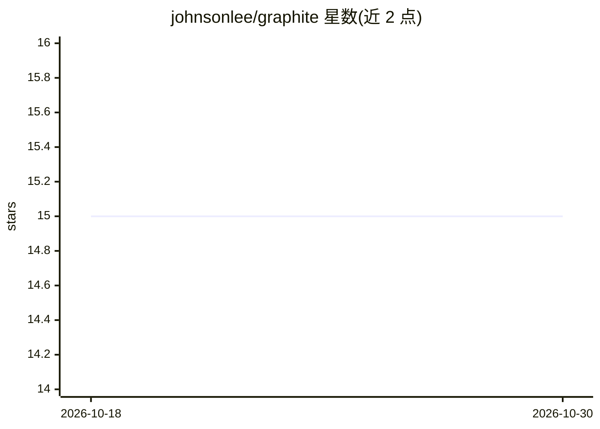

# johnsonlee/graphite

⭐ 15 · Kotlin · Apache-2.0 · 推送 2026-10-29 · [GitHub](https://github.com/johnsonlee/graphite) · [官网](https://johnsonlee.io/graphite/) · 个人维护 · 中文 README

**把 JVM 字节码转为可查询程序图，为 LLM 提供代码库上下文**

Graphite 从 JVM/Android 编译产物（JAR/APK）构建程序图：节点为程序元素，边为调用、数据流、类型层次等关系。AI agent 可通过 MCP 用 Cypher 查询图并获得结构化结果，同一图也可经 CLI 与 Web Explorer 访问。从字节码出发，因此可分析应用与第三方依赖而无需其源码；单进程可服务 40+ 图、100M+ 节点。局限：静态分析，反射与动态加载可能无法解析关系；图构建需要 Java（JDK 17+），APK 分析需 Android platform jars。提供 Homebrew 安装与 Kotlin API。

## 筛选速览

| 维度 | 判定 | 备注 |
|---|---|---|
| AI 角色 | `ai-ecosystem` | LLM/agent 周边工具 |
| 许可风险 | `permissive` | Apache-2.0 |
| 部署形态 | `library` | 以包/库形式分发 |
| 模型依赖 | — | README 未给出锁定关系 |
| 硬件要求 | — | 无带数字的原话,不猜 |
| 安装摩擦 | `medium` | 含编译或系统依赖之一 |
| 成熟度 | — | 结构信号不足 |

## 能力要点

- 字节码前端：无源码即可分析应用与第三方依赖的 JAR/APK
- 通过 MCP 以 Cypher 查询程序图，供 AI agent 获取结构化上下文
- 生产规模：单进程 40+ 图、100M+ 节点，附 64 图 19.4M 节点公开演示
- --fold 特性门折叠：图构建时按规则折叠特性开关分支

## 适用场景

- 让编码 agent 回答跨文件的调用/数据流问题而无需读取全部代码
- 查询哪些常量流入某 API、某方法被谁调用、哪些类型实现某接口
- 在大型 Android/JVM 代码库上做规模化代码关系检索

## 场景标签

`语义搜索` · 领域:知识与检索

## 证据(README 行号)

> L7: **Structured codebase context for LLMs.** Graphite turns JVM bytecode into a queryable program graph — so AI agents 
> L30: Graphite builds a **program graph**: nodes represent program elements and edges
> L31: represent relationships such as calls and dataflow. An agent can discover the
> L32: schema, query the graph with Cypher through MCP, and receive structured results.

## 星数曲线

2026-10-18 15 → 2026-10-30 15（+0）

---
*卡片 v1 · prompt 1.4 · 生成 2026-10-30 · 置信度 mid · 依据 README sha `fa86f4d67e2a` · [字段定义](../../DATASET.md)*
