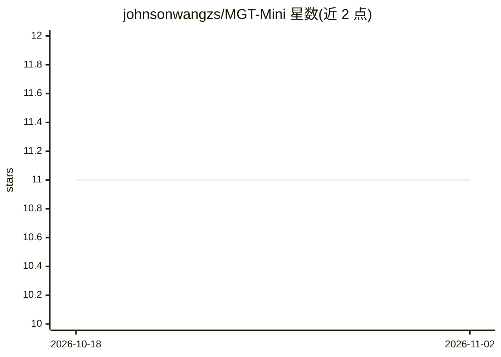

# johnsonwangzs/MGT-Mini

⭐ 11 · Python · 推送 2026-01-19 · [GitHub](https://github.com/johnsonwangzs/MGT-Mini) · 组织维护 · 中文 README

**中文 LLM 生成文本检测系统：NLPCC'25 任务第一名方案代码**

NLPCC2025 共享任务 1（中文机器生成文本检测）第一名方案 EnsemJudge 的竞赛阶段代码。集成多种检测器：基于规则（常见机器短语、词频偏好、连续标点等）、微调 BERT/RoBERTa、微调 LLM（GLM-4-9B、Qwen2.5-7B LoRA）以及 Fast-DetectGPT、Binoculars 零样本方法，串行推理后投票得出预测。需从金山文档下载数据、从 Hugging Face 下载模型与训练权重，首次运行需两张 V100 级以上 GPU。README 声明系统已扩展，此仓库仅展示竞赛中间代码。

## 筛选速览

| 维度 | 判定 | 备注 |
|---|---|---|
| AI 角色 | `ai-native` | 本体是模型或模型工具 |
| 许可风险 | `none` | — |
| 部署形态 | `None` |  |
| 模型依赖 | — | README 未给出锁定关系 |
| 硬件要求 | — | 无带数字的原话,不猜 |
| 安装摩擦 | `low` | 无编译、无系统依赖或容器化 |
| 成熟度 | `idea` | |

## 能力要点

- 规则、BERT 类、LLM 微调与零样本方法（Fast-DetectGPT/Binoculars）多模型集成
- 各子模型串行推理后投票得出最终预测
- 包含 LoRA/SFT 训练脚本与数据构建脚本

## 适用场景

- 复现 NLPCC2025 中文机器文本检测竞赛方案
- 研究多模型集成在 AIGC 检测中的应用
- 基于现有检测器构建自己的中文文本检测流程

## 场景标签

 · 领域:NLP/AIGC 检测

## 证据(README 行号)

> L3: Code for NLPCC2025 (Shared Task1) paper: **EnsemJudge: Enhancing Reliability in Chinese LLM-Generated Text Detection
> L54: `ensemble_model.py`：集成模型，实现全流程控制。定义了各子模型的配置参数并实例化各子模型，实现各子模型的串行推理，进行投票得出最终预测结果
> L70: + `fast_detectgpt.py`：定义了 `FastDetectGPT`类，实现了 Fast-DetectGPT 零样本检测方法（https://arxiv.org/abs/2310.05130）

## 星数曲线

2026-10-18 11 → 2026-11-02 11（+0）

---
*卡片 v1 · prompt 1.4 · 生成 2026-11-02 · 置信度 high · 依据 README sha `a1aa6ebadc43` · [字段定义](../../DATASET.md)*
