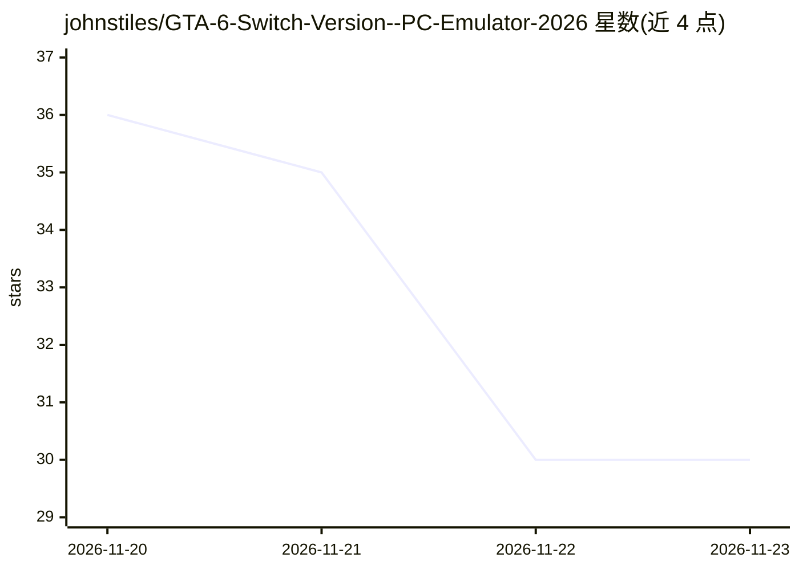

# johnstiles/GTA-6-Switch-Version--PC-Emulator-2026

⭐ 30 · Rust · Apache-2.0 · 推送 2026-11-21 · [GitHub](https://github.com/johnstiles/GTA-6-Switch-Version--PC-Emulator-2026) · 个人维护

**面向 Windows 玩家的 GTA VI PC 版安装与配置准备指南**

为尚未正式发售 PC 版的 Grand Theft Auto VI 提供安装与配置准备资料：覆盖 Windows 系统检查、显卡驱动更新、存储空间核查、Rockstar Games Launcher 准备、图形画质选项说明与 FPS 排障清单。仓库提供一个 Windows 伴生安装器（.exe），README 声明其不包含或安装游戏本体文件，游戏需从授权渠道获取；官方系统需求表当前全部标记为未确认。

## 筛选速览

| 维度 | 判定 | 备注 |
|---|---|---|
| AI 角色 | `ai-knowledge` | 知识聚合/清单类 |
| 许可风险 | `permissive` | Apache-2.0 |
| 部署形态 | `desktop` | 安装包/桌面程序 |
| 模型依赖 | — | README 未给出锁定关系 |
| 硬件要求 | — | 无带数字的原话,不猜 |
| 安装摩擦 | `low` | 无编译、无系统依赖或容器化 |
| 成熟度 | — | 结构信号不足 |

## 能力要点

- Windows 兼容性准备清单（DirectX、驱动、存储检查）
- 常见 FPS 低、卡顿、显示与安装错误排障条目
- 官方系统需求表当前全部标记 Not confirmed
- 提供 NVIDIA/AMD/Intel 驱动与 Rockstar 官方资源链接

## 适用场景

- 为将来 GTA VI PC 版发售提前准备 Windows 环境
- 排查 PC 游戏常见的低帧率与卡顿问题
- 查找 Rockstar Games Launcher 等官方资源入口

## 场景标签

 · 领域:游戏/桌面工具

## 证据(README 行号)

> L3: ### GTA 6 PC Installation, Setup & Performance Guide
> L5: A dedicated PC installation and configuration resource for Grand Theft Auto VI, covering Windows preparation, graphi

## 星数曲线

2026-11-20 36 → 2026-11-23 30（-6）

---
*卡片 v1 · prompt 1.4 · 生成 2026-11-22 · 置信度 low · 依据 README sha `2fe487426686` · [字段定义](../../DATASET.md)*
