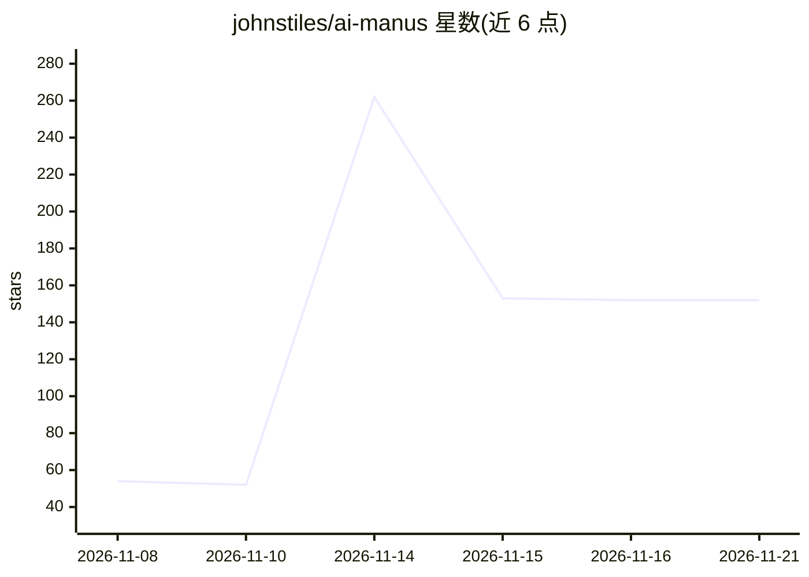

# johnstiles/ai-manus

⭐ 152 · Python · Apache-2.0 · 推送 2026-11-19 · [GitHub](https://github.com/johnstiles/ai-manus) · 个人维护

**自主执行代码与控制浏览器的通用 AI Agent 系统**

Manus 定位为自主 AI agent：代表用户编写并执行脚本、打开网页并与之交互、执行多步任务，README 面向家庭、学习与轻量办公场景的非开发者用户描述功能，并给出 CPU/内存/存储等兼容性参考表。README 仅含功能宣传与'下载'链接，未提供任何安装命令、依赖说明、API 密钥配置或模型接入方式等可验证的运行细节，'Starting with Manus' 一节为通用操作建议而非具体步骤。

## 筛选速览

| 维度 | 判定 | 备注 |
|---|---|---|
| AI 角色 | `ai-native` | 本体是模型或模型工具 |
| 许可风险 | `permissive` | Apache-2.0 |
| 部署形态 | `None` |  |
| 模型依赖 | — | README 未给出锁定关系 |
| 硬件要求 | — | 无带数字的原话,不猜 |
| 安装摩擦 | `low` | 无编译、无系统依赖或容器化 |
| 成熟度 | — | 结构信号不足 |

## 能力要点

- agent 可自主编写并执行代码完成多步任务
- 支持浏览器控制：导航网页、填写表单、采集信息
- 代码执行与浏览器操作可在同一工作流中衔接

## 适用场景

- 让 agent 代为完成重复性的代码与浏览器操作
- 多网页信息收集与小型报告整理
- 学习研究中运行小脚本、组织笔记

## 场景标签

`AI 助手` `浏览器自动化` `编码 Agent` · 领域:效率与自动化

## 证据(README 行号)

> L10: - **Autonomous Code Execution:** Manus AI agent runs code on its own to complete tasks, so you can focus on decisio
> L18: Manus is an autonomous AI agent designed to run code and control a browser on your behalf. Instead of acting like a

## 星数曲线

2026-11-08 54 → 2026-11-21 152（+98）

---
*卡片 v1 · prompt 1.4 · 生成 2026-11-17 · 置信度 mid · 依据 README sha `0b7364c4f502` · [字段定义](../../DATASET.md)*
