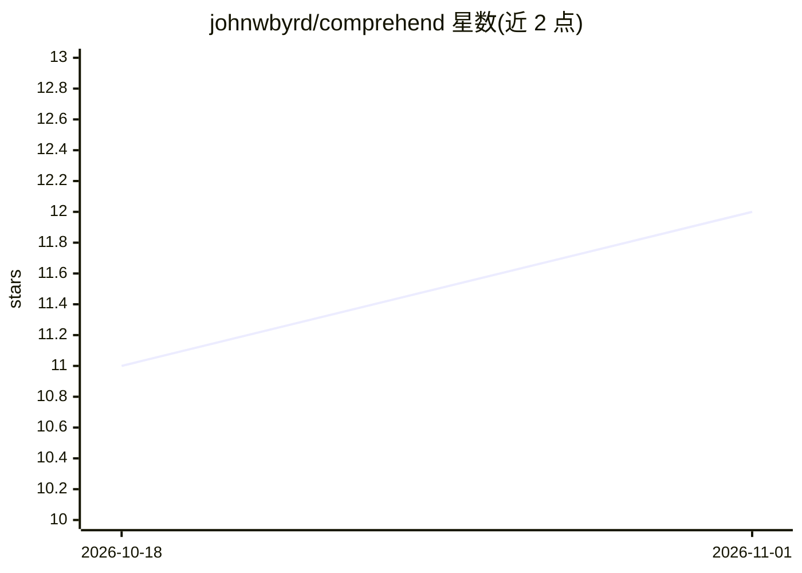

# johnwbyrd/comprehend

⭐ 12 · Python · AGPL-3.0 · 推送 2026-06-12 · [GitHub](https://github.com/johnwbyrd/comprehend) · 个人维护

**让 AI 编码代理系统化理解大型代码库的技能包**

面向 Claude Code、OpenAI、Gemini 等 AI 编码代理的技能（skill）包，目标是让代理在接触大型代码库前先做系统性理解。核心机制是度量优先协议：先测量文件规模与结构，按规模选择直接/递归/批量并行三种分析策略，将大文件按自然边界分块，由并行子代理读取分析，并通过基于 Unix socket 的持久 Python REPL 服务器在工具调用间保存状态、汇总结果，以减少上下文窗口占用。全部脚本为纯 Python 3、无外部依赖。README 明确提示 REPL 提供任意 Python 执行，需在沙箱环境使用。

## 筛选速览

| 维度 | 判定 | 备注 |
|---|---|---|
| AI 角色 | `ai-ecosystem` | LLM/agent 周边工具 |
| 许可风险 | `viral` | AGPL-3.0 |
| 部署形态 | `library` | 以包/库形式分发 |
| 模型依赖 | locked-api |  |
| 硬件要求 | — | 无带数字的原话,不猜 |
| 安装摩擦 | `low` | 无编译、无系统依赖或容器化 |
| 成熟度 | — | 结构信号不足 |

## 能力要点

- 度量优先协议：先测量代码库规模再选择分析策略
- 持久 Python REPL 服务器（Unix socket，Windows 上为 TCP）跨工具调用保存状态
- 按自然边界（函数定义、Markdown 标题、时间戳）分块大文件
- 纯 Python 3 脚本，无外部依赖；附 5 个实战示例模式

## 适用场景

- AI 编码代理处理大型代码库时避免耗尽上下文窗口
- 跨多文件构建架构理解与调用链追踪
- 日志分析、代码审查、文档问答等大文本分析任务

## 场景标签

`代码审查` `文档问答` `Agent 框架` · 领域:Agent 开发

## 证据(README 行号)

> L32: comprehend is a skill for Claude Code, OpenAI, Gemini, or your favorite LLM du jour. It provides:
> L11: comprehend teaches AI agents to *systematically understand* a codebase before touching it. Instead of dumping files

## 星数曲线

2026-10-18 11 → 2026-11-01 12（+1）

---
*卡片 v1 · prompt 1.4 · 生成 2026-11-01 · 置信度 high · 依据 README sha `8324aab27f69` · [字段定义](../../DATASET.md)*
