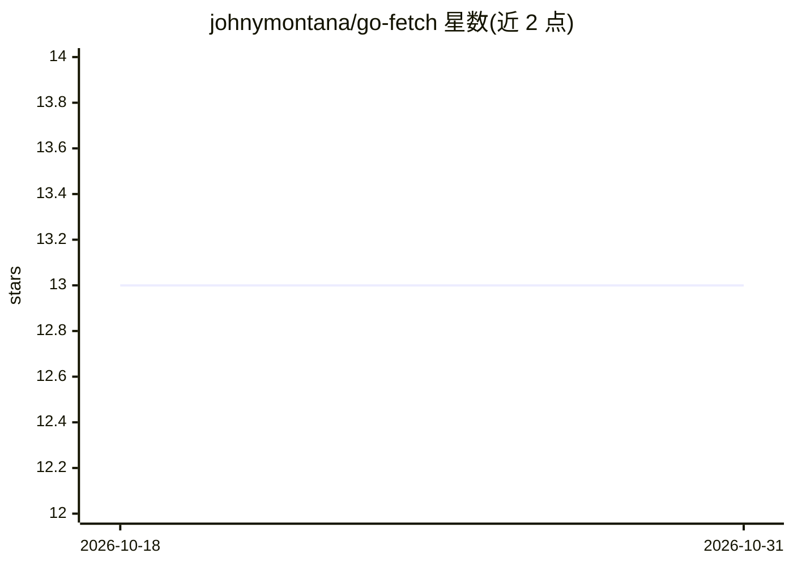

# johnymontana/go-fetch

⭐ 13 · TypeScript · 推送 2025-12-15 · [GitHub](https://github.com/johnymontana/go-fetch) · 个人维护

**给 AI agent 提供图数据库长期记忆的 MCP 服务器**

基于 TypeScript、Vercel AI SDK 与 Vercel MCP adapter 构建的 MCP 服务器，为 AI agent 提供两个工具：save_user_message（用 LLM 从消息抽取实体并存入图数据库）与 graph_memory_search（基于向量嵌入的语义检索）。后端支持 Dgraph 或 Neo4j（需 5.11+ 以支持向量索引），自动管理 schema 并建向量索引，支持社区发现与中心性等图算法。附带 Locomo-10 记忆基准数据集的摄取与评测脚本。需 OpenAI 或 Anthropic API key、Node.js 20+ 与一个图数据库实例。

## 筛选速览

| 维度 | 判定 | 备注 |
|---|---|---|
| AI 角色 | `ai-ecosystem` | LLM/agent 周边工具 |
| 许可风险 | `none` | — |
| 部署形态 | `self-host` | docker 或自建部署 |
| 模型依赖 | — | README 未给出锁定关系 |
| 硬件要求 | — | 无带数字的原话,不猜 |
| 安装摩擦 | `low` | 无编译、无系统依赖或容器化 |
| 成熟度 | — | 结构信号不足 |

## 能力要点

- 统一接口适配 Dgraph 与 Neo4j 两种图数据库后端
- LLM 实体抽取 + HNSW 向量索引的记忆存取两个 MCP 工具
- 图算法分析（社区发现、中心性）
- Locomo-10 AI agent 记忆基准数据集摄取与评测脚本

## 适用场景

- 为 MCP 客户端接入图结构长期记忆
- 跨多会话对话构建实体关系知识图谱并语义检索
- 在 Locomo-10 基准上评测 agent 记忆系统

## 场景标签

`Agent 记忆` · 领域:Agent 开发

## 证据(README 行号)

> L1: # Go Fetch - MCP Server for Graph-Based Memory
> L5: An MCP (Model Context Protocol) server that provides graph-based memory tools for AI agents using either **Dgraph** 
> L14: - **Two MCP Tools**:

## 星数曲线

2026-10-18 13 → 2026-10-31 13（+0）

---
*卡片 v1 · prompt 1.4 · 生成 2026-10-31 · 置信度 mid · 依据 README sha `2f11da110738` · [字段定义](../../DATASET.md)*
