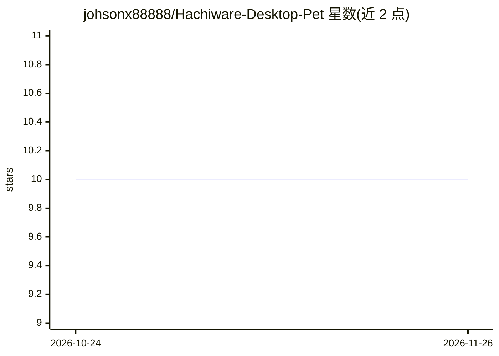

# johsonx88888/Hachiware-Desktop-Pet

⭐ 10 · Python · 推送 2026-03-24 · [GitHub](https://github.com/johsonx88888/Hachiware-Desktop-Pet) · 个人维护 · 中文 README

**基于大模型对话与视觉追踪的 Windows 桌面宠物助理**

以 Python/Tkinter 实现的桌面宠物程序，提供实时人脸/目标视觉追踪（OpenCV）、基于 ReAct 循环的多轮对话与工具调用链路、微信转账收取的桌面自动化（PyAutoGUI）、后台执行终端命令与 Python 脚本并自我纠错、CosyVoice 双音色语音合成。模型能力通过 DeepSeek API 与 Qwen-VL 远程接入，需在配置文件填入 SiliconFlow 的 API Key。提供免安装 exe 版与 uv 管理的源码运行方式，仅面向 Windows 桌面环境。

## 筛选速览

| 维度 | 判定 | 备注 |
|---|---|---|
| AI 角色 | `ai-native` | 本体是模型或模型工具 |
| 许可风险 | `none` | — |
| 部署形态 | `desktop` | 安装包/桌面程序 |
| 模型依赖 | locked-api |  |
| 硬件要求 | — | 无带数字的原话,不猜 |
| 安装摩擦 | `low` | 无编译、无系统依赖或容器化 |
| 成熟度 | — | 结构信号不足 |

## 能力要点

- ReAct 循环 Agent：多轮对话并自主决定工具调用链路
- OpenCV 实时人脸/目标检测驱动的视觉跟随
- Function Calling 操作宿主机：执行 CMD/PowerShell 与 Python 脚本并自动纠错
- FunAudioLLM/CosyVoice 双音色语音合成

## 适用场景

- 在 Windows 桌面养一只会注视你的 AI 聊天宠物
- 让桌宠通过对话自动收取微信转账
- 通过对话让 AI 代为执行本地终端命令或脚本

## 场景标签

`GUI 自动化` `语音合成` `目标检测` · 领域:效率与自动化

## 证据(README 行号)

> L2: > **基于 OpenCV 视觉追踪与大模型交互的智能桌面助理**
> L10: * **Agent 智能体架构（ReAct Loop）**：重构了底层的 LLM 路由逻辑，引入基于 ReAct 范式的自主状态循环。小八不仅能进行多轮对话，还能根据任务复杂度自主决定工具的调用链路。
> L22: * **Intelligence**: DeepSeek API (Agent Reasoning) / Qwen-VL (Vision Logic)

## 星数曲线

2026-10-24 10 → 2026-11-26 10（+0）

---
*卡片 v1 · prompt 1.4 · 生成 2026-11-19 · 置信度 high · 依据 README sha `79733631b6b3` · [字段定义](../../DATASET.md)*
