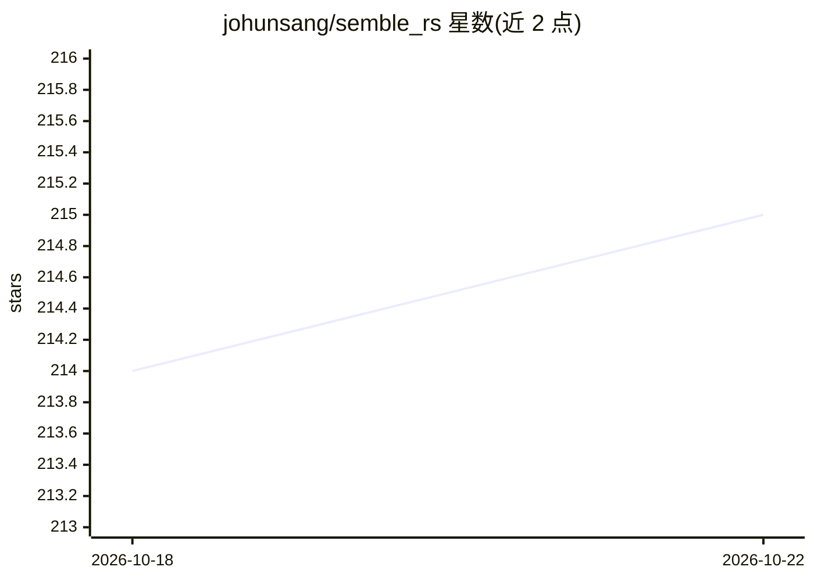

# johunsang/semble_rs

⭐ 215 · Rust · 推送 2026-06-01 · [GitHub](https://github.com/johunsang/semble_rs) · [官网](https://github.com/johunsang/semble_rs) · 个人维护

**给 AI 编码代理用的 Rust 代码搜索与 CI 输出压缩 CLI**

用 Rust 编写的单二进制命令行工具，为 AI 编码代理（Claude Code、Codex、Cursor、Aider、OpenHands）替代 grep/cat/read/ls：以 Tree-sitter 在函数/类边界分块，BM25 + Model2Vec 静态嵌入经 RRF 融合与代码感知重排进行混合检索；提供依赖图（deps/impact）、代码库树（tree，压缩 ls -R 输出）、digest 管道压缩构建/测试/CI 日志（实测 15 个样例 -98.7%）。无守护进程、无 API key、CPU 运行，首次运行从 HuggingFace 下载约 60 MB 默认嵌入模型。索引自称是 MinishLab/semble（Python 版）的移植+超集。

## 筛选速览

| 维度 | 判定 | 备注 |
|---|---|---|
| AI 角色 | `ai-ecosystem` | LLM/agent 周边工具 |
| 许可风险 | `permissive` | — |
| 部署形态 | `library` | 以包/库形式分发 |
| 模型依赖 | — | README 未给出锁定关系 |
| 硬件要求 | `cpu-ok` | |
| 安装摩擦 | `low` | 无编译、无系统依赖或容器化 |
| 成熟度 | — | 结构信号不足 |

## 能力要点

- BM25 + Model2Vec 静态嵌入混合检索（RRF 融合 + 代码感知重排）
- digest 自动识别 cargo/pytest/go test/gradle/GitHub Actions 等 15 类构建/CI 输出并压缩
- tree 替代 ls -R，实测输出缩减 9×–747×
- deps/impact 依赖图与 find-related 语义关联查询

## 适用场景

- 让 AI 编码代理用更少 token 定位和读取代码库
- 编辑共享模块前用 impact 查看影响范围
- 压缩 CI/构建日志后喂给代理分析失败原因

## 场景标签

 · 领域:开发者工具/AI 代理基础设施

## 证据(README 行号)

> L7: `semble_rs` is a Rust port and superset of MinishLab/semble built for AI coding agents. It returns the exact code ch
> L162: Append a snippet like the following to your project-root `CLAUDE.md` or `AGENTS.md`. It works for Claude Code, Cod

## 星数曲线

2026-10-18 214 → 2026-10-22 215（+1）

---
*卡片 v1 · prompt 1.4 · 生成 2026-10-22 · 置信度 mid · 依据 README sha `2b67864415f1` · [字段定义](../../DATASET.md)*
