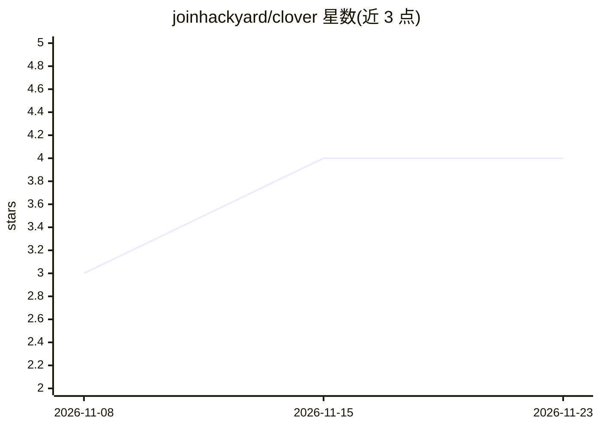

# joinhackyard/clover

⭐ 4 · Python · MIT · 推送 2026-10-31 · [GitHub](https://github.com/joinhackyard/clover) · [官网](https://hackyard.org) · 组织维护

**macOS 语音 AI 助手：说话+指点屏幕，免手操作 Mac**

驻留在 Mac 上的语音助手，通过 ⌃⌥空格 或唤醒词「Clover」启动，支持语音输入、屏幕读取、窗口管理、文件内容搜索、听写插入、屏幕标注讲解、后台 agent 与例行任务、会议 Copilot 等功能。AI 供应商可在设置中切换：Claude Code（默认）、Antigravity、Claude/OpenAI/Azure/Gemini 等多家 API、Ollama 本地模型或任意 OpenAI 兼容服务。内置三级安全模式与命令黑名单（rm/sudo/git push 等始终拦截）。需 macOS 26+，MIT 许可，语音识别在本地进行。

## 筛选速览

| 维度 | 判定 | 备注 |
|---|---|---|
| AI 角色 | `ai-native` | 本体是模型或模型工具 |
| 许可风险 | `permissive` | MIT |
| 部署形态 | `None` |  |
| 模型依赖 | local-ok | 支持本地模型 |
| 硬件要求 | — | 无带数字的原话,不猜 |
| 安装摩擦 | `low` | 无编译、无系统依赖或容器化 |
| 成熟度 | — | 结构信号不足 |

## 能力要点

- 多 AI 供应商可切换：Claude Code、Antigravity、各家 API、Ollama 本地模型
- 语音与唤醒词在 Mac 本地识别，语音不外传
- 三级安全模式加统一命令黑名单（rm、sudo、git push 等拦截）
- Force Touch 触控板手势交互与屏幕指点提问

## 适用场景

- 一句话排布多显示器上的窗口和应用
- 在任意输入框语音听写并让 AI 清理口语
- 开会时获得实时提示与本地转录纪要

## 场景标签

`语音 Agent` `AI 助手` `GUI 自动化` · 领域:效率与自动化

## 证据(README 行号)

> L7:  A little clover that lives on your Mac. Hold ⌃ ⌥ space or just say “Clover” , and ask.
> L69:  Bring your own AI
> L71: Settings → Intelligence → **AI provider**:

## 星数曲线

2026-11-08 3 → 2026-11-23 4（+1）

---
*卡片 v1 · prompt 1.4 · 生成 2026-11-21 · 置信度 high · 依据 README sha `ad09f12373f3` · [字段定义](../../DATASET.md)*
