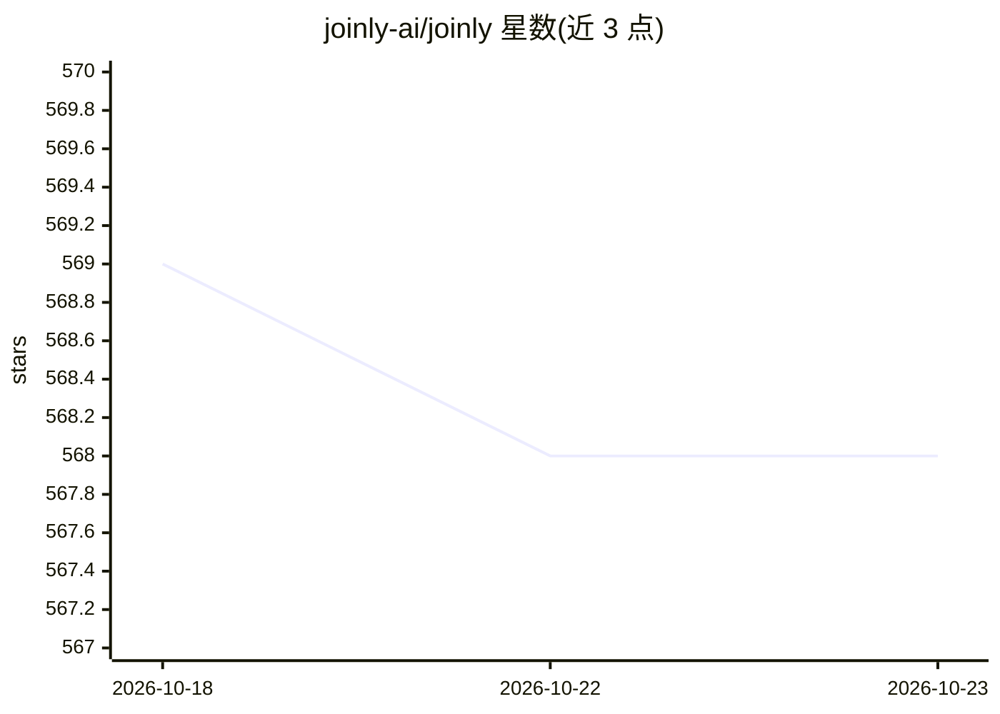

# joinly-ai/joinly

⭐ 568 · Python · MIT · 推送 2026-09-01 · [GitHub](https://github.com/joinly-ai/joinly) · [官网](https://joinly.ai) · 组织维护

**让 AI Agent 加入并参与视频会议的连接中间件（MCP）**

joinly.ai 是自托管的开源连接中间件，通过 MCP server 提供会议工具与资源，使任意 AI agent 能加入 Zoom、Google Meet、Teams 等视频会议，以语音或聊天实时交互并执行任务。支持自选 LLM 提供商（含本地 Ollama）、模块化 STT/TTS（Whisper/Deepgram、Kokoro/ElevenLabs/Deepgram），内置处理打断与多说话人的对话逻辑。以 Docker 镜像（约 2.3GB，打包浏览器与模型）分发，可选 CUDA 镜像运行转录与 TTS；MCP server 无鉴权，限定本地单可信客户端使用。另提供 joinly cloud 托管服务。

## 筛选速览

| 维度 | 判定 | 备注 |
|---|---|---|
| AI 角色 | `ai-ecosystem` | LLM/agent 周边工具 |
| 许可风险 | `permissive` | MIT |
| 部署形态 | `self-host` | docker 或自建部署 |
| 模型依赖 | local-ok | 支持本地模型 |
| 硬件要求 | — | 无带数字的原话,不猜 |
| 安装摩擦 | `low` | 无编译、无系统依赖或容器化 |
| 成熟度 | — | 结构信号不足 |

## 能力要点

- MCP server 提供 join_meeting/speak_text/get_transcript 等 10 类会议工具与实时字幕资源
- 跨平台接入 Zoom/Google Meet/Teams（或任何浏览器可用的会议）
- 自选 LLM 提供商（含本地 Ollama）与模块化 STT/TTS（Whisper/Kokoro 等本地默认）
- Docker 镜像分发，提供 CUDA GPU 支持变体

## 适用场景

- 让 AI 助手加入我的会议并实时语音/聊天应答
- 通过 MCP 给会议中的 agent 挂接外部工具（如网页搜索、Notion）
- 获取会议实时转录、聊天记录与参会者信息供 agent 使用

## 场景标签

`语音 Agent` · 领域:对话与助手

## 证据(README 行号)

> L23: **joinly.ai** is a connector middleware designed to enable AI agents to join and actively participate in video call
> L35: - **Bring-your-own-LLM**: Works with all LLM providers (also locally with Ollama)

## 星数曲线

2026-10-18 569 → 2026-10-23 568（-1）

---
*卡片 v1 · prompt 1.4 · 生成 2026-10-21 · 置信度 high · 依据 README sha `e49e8b475d72` · [字段定义](../../DATASET.md)*
