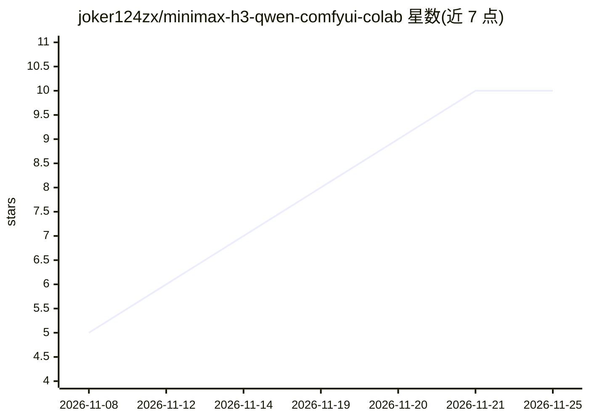

# joker124zx/minimax-h3-qwen-comfyui-colab

⭐ 10 · Jupyter Notebook · 推送 2026-11-15 · [GitHub](https://github.com/joker124zx/minimax-h3-qwen-comfyui-colab) · 个人维护 · 中文 README

**给内容创作者的单文件 Colab：一键云端部署 ComfyUI 跑视频/图像生成**

一个单文件 Google Colab 笔记本，在云端 GPU（默认 G4/RTX PRO 6000 Blackwell 96GB，可切换 A100/H100/L4）上部署 ComfyUI，按需加载 MiniMax-H3、FastH3-Omni、HyperFlow、H3-Image 与 Qwen-Image 2.1 等底模，内置 36 套工作流，覆盖文生视频、图生视频、数字人、文生图与改图等。通过 8 个单元格组织安装、模型加载与隧道重启；含页缓存释放、防休眠保活与崩溃自动重启等 Colab 环境适配机制。模型下载默认走 Hugging Face，Civitai 需自填 API Token。

## 筛选速览

| 维度 | 判定 | 备注 |
|---|---|---|
| AI 角色 | `ai-native` | 本体是模型或模型工具 |
| 许可风险 | `none` | — |
| 部署形态 | `None` |  |
| 模型依赖 | — | README 未给出锁定关系 |
| 硬件要求 | — | 无带数字的原话,不猜 |
| 安装摩擦 | `low` | 无编译、无系统依赖或容器化 |
| 成熟度 | — | 结构信号不足 |

## 能力要点

- 单文件 Colab 笔记本一键部署 ComfyUI，默认 G4 96GB 显卡可切换
- 内置 36 套工作流，分 H3 视频、三合一、千问图像三个隔离池
- 云flare 隧道访问 + 15 秒巡检、闪退 3 秒自动原地重启守护
- 页缓存主动释放（os.sync + cache-ram 封顶）防止容器内存被顶爆

## 适用场景

- 在 Colab 免费云端生成文生/图生视频而不占用本地显卡
- 用多图/音频/视频参考生成音画同步的 AI 视频
- 批量运行文生图、改图、换装、姿势迁移等 Qwen-Image 工作流

## 场景标签

`图像生成` `视频生成` · 领域:内容生成

## 证据(README 行号)

> L15: 一个 **单文件 Google Colab 笔记本**，一键在云端 GPU（默认推荐 **G4 / RTX PRO 6000 Blackwell 96GB**，支持随时手动切换 A100 / H100 / L4）上部署 **Com
> L17: - **MiniMax-H3 (31B)**：文生视频、首尾帧图生视频、1:1 九宫格多图/视频/音频全能参考视频（Ref2VA）、Pika 6步 2K 超清放大、二阶段一采成型二采修脸、无限时长数字人（像素幻想Lab双采版）、P
> L39: - 🧩 **按需切换架构 & 三池完全隔离**：经典 H3 视频池（11 套）、HyperFlow+ErosMax+H3-Image 三合一池（12 套）、千问图像池（13 套）共 **36 套精调工作流**完全隔离，合法 RFC

## 星数曲线

2026-11-08 5 → 2026-11-25 10（+5）

---
*卡片 v1 · prompt 1.4 · 生成 2026-11-20 · 置信度 high · 依据 README sha `a4bb134d629b` · [字段定义](../../DATASET.md)*
