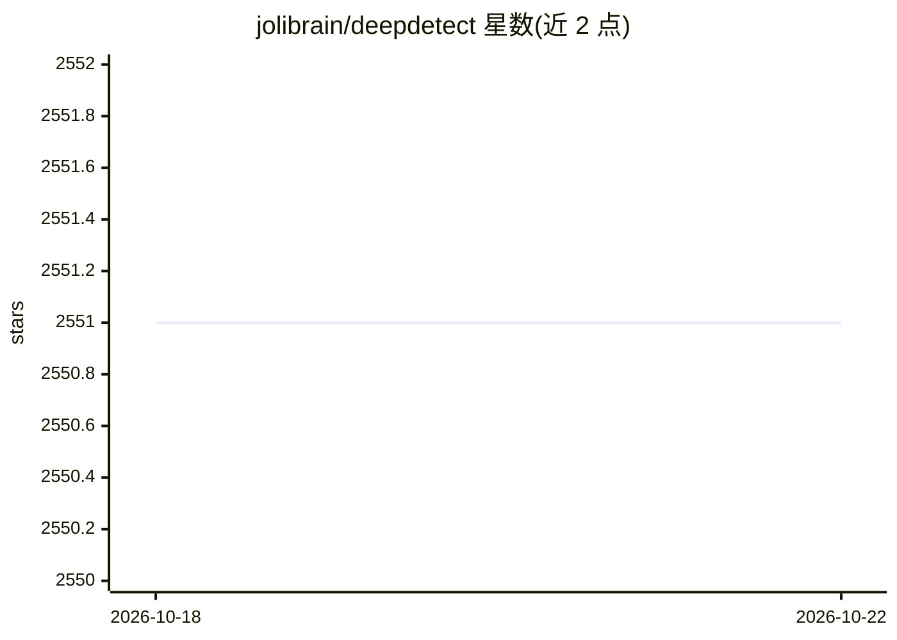

# jolibrain/deepdetect

⭐ 2,551 · C++ · NOASSERTION · 推送 2026-10-21 · [GitHub](https://github.com/jolibrain/deepdetect) · [官网](https://www.deepdetect.com/) · 组织维护

**深度学习训练与推理服务器及 CLI 运行时**

DeepDetect 提供深度学习运行时、命令行工具与 REST 服务器，覆盖创建服务、训练模型、运行预测、监控任务与文件系统模型仓库管理。以 Python wheel 形式嵌入当前环境并提供 deepdetect CLI（deepdetect-cpu / deepdetect-gpu 两种互斥变体），另保留长驻 REST 服务器用于容器化部署。后端以 Torch 为主，TensorRT 用于优化推理，Caffe 非活跃后端；支持图像、文本、表格、时间序列等数据，CLI 打包 YOLOX 与 SegFormer 工作流，YAML 配置使运行可重复。LGPL v3.0 许可，由 Jolibrain 维护。

## 筛选速览

| 维度 | 判定 | 备注 |
|---|---|---|
| AI 角色 | `ai-ecosystem` | LLM/agent 周边工具 |
| 许可风险 | `none` | NOASSERTION |
| 部署形态 | `library` | 以包/库形式分发 |
| 模型依赖 | — | README 未给出锁定关系 |
| 硬件要求 | — | 无带数字的原话,不猜 |
| 安装摩擦 | `medium` | 含编译或系统依赖之一 |
| 成熟度 | — | 结构信号不足 |

## 能力要点

- 单一 API 覆盖训练、推理、异步任务监控与模型服务管理
- Python wheel 内嵌运行时并提供 deepdetect CLI（CPU/GPU 变体）
- Torch 主后端，TensorRT 可用于优化推理
- 文件系统模型存储，无数据库依赖

## 适用场景

- 用 CLI 或 REST API 完成目标检测、语义分割等模型的训练与推理
- 搭建长驻 REST 服务做容器化模型部署
- 通过 YAML 配置实现可重复的模型工作流

## 场景标签

`目标检测` `推理引擎` `模型训练` · 领域:感知与多模态

## 证据(README 行号)

> L9: DeepDetect is a deep learning runtime, command-line tool, and REST server for
> L15: DeepDetect focuses on practical model operations: create services, train
> L127: DeepDetect uses **Torch** as the primary backend for training and inference.

## 星数曲线

2026-10-18 2,551 → 2026-10-22 2,551（+0）

---
*卡片 v1 · prompt 1.4 · 生成 2026-10-21 · 置信度 high · 依据 README sha `9279af1f44b6` · [字段定义](../../DATASET.md)*
