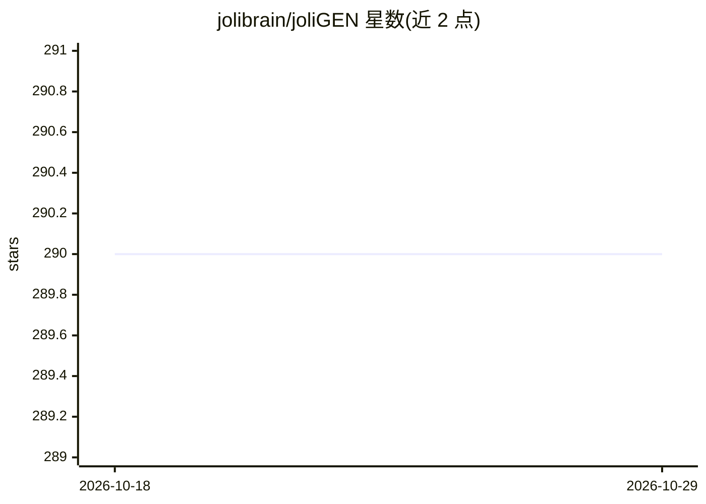

# jolibrain/joliGEN

⭐ 290 · Python · NOASSERTION · 推送 2026-10-27 · [GitHub](https://github.com/jolibrain/joliGEN) · [官网](https://www.joligen.com) · 组织维护

**面向真实应用的图像到图像生成模型训练框架（GAN/扩散/一致性模型）**

Jolibrain 维护的生成式 AI 图像与视频工具集：集成 GAN、Diffusion 与 Consistency 模型，用于成对/非成对图像到图像翻译、风格迁移、物体插入与删除、图像修复等任务，强调语义保持（标签框、掩码、类别等）。提供带 REST API 的服务器、Docker 化部署与 CPU/GPU 支持，可通过 DeepDetect 做 C++ 生产部署。基于 PyTorch，代码结构参考 pytorch-CycleGAN-and-pix2pix 等项目。

## 筛选速览

| 维度 | 判定 | 备注 |
|---|---|---|
| AI 角色 | `ai-native` | 本体是模型或模型工具 |
| 许可风险 | `none` | NOASSERTION |
| 部署形态 | `library` | 以包/库形式分发 |
| 模型依赖 | — | README 未给出锁定关系 |
| 硬件要求 | — | 无带数字的原话,不猜 |
| 安装摩擦 | `low` | 无编译、无系统依赖或容器化 |
| 成熟度 | — | 结构信号不足 |

## 能力要点

- GAN、Diffusion、Consistency 模型的图像到图像翻译训练
- 语义一致性保持：边界框、掩码、类别标注等
- 带 REST API 的服务器与 Docker 化部署
- 输出质量指标：FID、PSNR、KID

## 适用场景

- AR/元宇宙中替换图像元素为逼真物体
- 数据集智能增强（缓解类别不平衡、扩充测试集）
- 仿真到真实的图像转换并保持标注与度量
- 物体插入与移除，如虚拟试穿、眼镜移除

## 场景标签

`图像生成` `模型训练` · 领域:内容生成

## 证据(README 行号)

> L7: **JoliGEN** is an integrated framework for training custom generative AI image-to-image models
> L11: - JoliGEN implements both **GAN, Diffusion and Consistency models** for unpaired and paired image to image translat

## 星数曲线

2026-10-18 290 → 2026-10-29 290（+0）

---
*卡片 v1 · prompt 1.4 · 生成 2026-10-22 · 置信度 mid · 依据 README sha `2e7733f1771e` · [字段定义](../../DATASET.md)*
