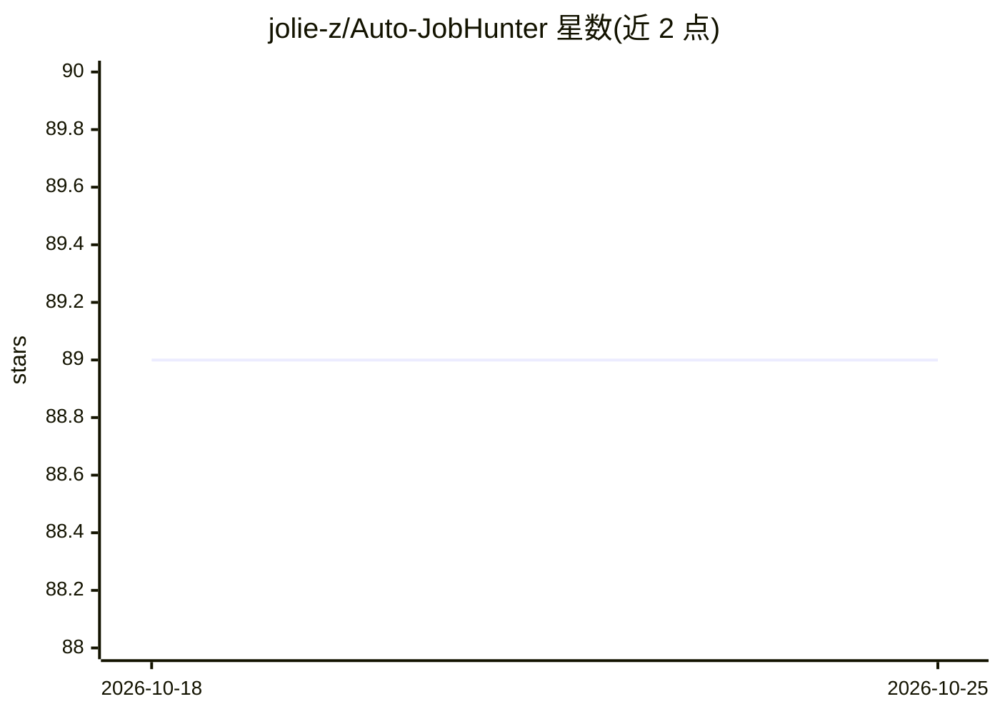

# jolie-z/Auto-JobHunter

⭐ 89 · Python · NOASSERTION · 推送 2026-10-02 · [GitHub](https://github.com/jolie-z/Auto-JobHunter) · 个人维护 · 中文 README

**多平台（BOSS/51job/猎聘）全自动求职系统：抓取+LLM 评估+自动投递**

面向国内求职者的自动化求职系统，覆盖 BOSS 直聘、前程无忧、猎聘三个平台。工作流为 Playwright/DrissionPage 抓取岗位→SQLite(WAL) 入库→JSON 词库硬规则一票否决过滤→LangGraph 四阶段 Agent（Splitter/Architect/Critic/Formatter）评估与简历/话术重写（80 分放行机制）→RPA 静默投递，并与飞书多维表格双向同步。前端为 Next.js+SSE 控制台。限制：强依赖 macOS（osascript、Mac 版 Word PDF 转换），需配置飞书应用与 OpenAI 格式 API Key。本仓库为 v1 存档，升级版已迁移至 jolie-z/jobhunter-ai。

## 筛选速览

| 维度 | 判定 | 备注 |
|---|---|---|
| AI 角色 | `ai-enhanced` | 去掉 AI 部分产品仍成立 |
| 许可风险 | `none` | NOASSERTION |
| 部署形态 | `library` | 以包/库形式分发 |
| 模型依赖 | — | README 未给出锁定关系 |
| 硬件要求 | — | 无带数字的原话,不猜 |
| 安装摩擦 | `low` | 无编译、无系统依赖或容器化 |
| 成熟度 | — | 结构信号不足 |

## 能力要点

- 三大招聘平台的防风控抓取（Playwright Stealth、DOM 穿透、鼠标轨迹模拟）
- LangGraph 四阶段多智能体简历/话术重写，含 80 分放行打分机制
- 硬规则词库一票否决 + LLM 深度评估的双漏斗过滤
- 飞书多维表格双向同步与 Next.js SSE 实时控制台

## 适用场景

- 自动化抓取并筛选 BOSS/猎聘/51job 的岗位信息
- 让 LLM 按岗位 JD 重写简历与投递话术后自动投递
- 在飞书手机端查看 AI 汇总的岗位大盘与求职进度

## 场景标签

`浏览器自动化` `网页抓取` · 领域:效率与自动化

## 证据(README 行号)

> L14: Auto-Job-Hunter 是一个工业级的多平台全自动求职系统。它不仅仅是一个爬虫，而是一个集成了 **DOM 穿透抓取、多智能体(Multi-Agent)简历重写、一票否决规则树、以及飞书云端大盘** 的硬核求职矩阵。
> L34:  * 告别单次大模型调用的敷衍。采用 `Splitter -> Architect -> Critic -> Formatter` 四阶段 Agent 工作流。
> L48: 抓取 (Scrape) ➡️ 入库 (SQLite) ➡️ 规则清洗 (Rule Filter) ➡️ 云端看板 (Feishu) ➡️ 深度评估 (LLM Agent) ➡️ 自动投递 (Auto Delivery)

## 星数曲线

2026-10-18 89 → 2026-10-25 89（+0）

---
*卡片 v1 · prompt 1.4 · 生成 2026-10-24 · 置信度 mid · 依据 README sha `686a4bd53103` · [字段定义](../../DATASET.md)*
