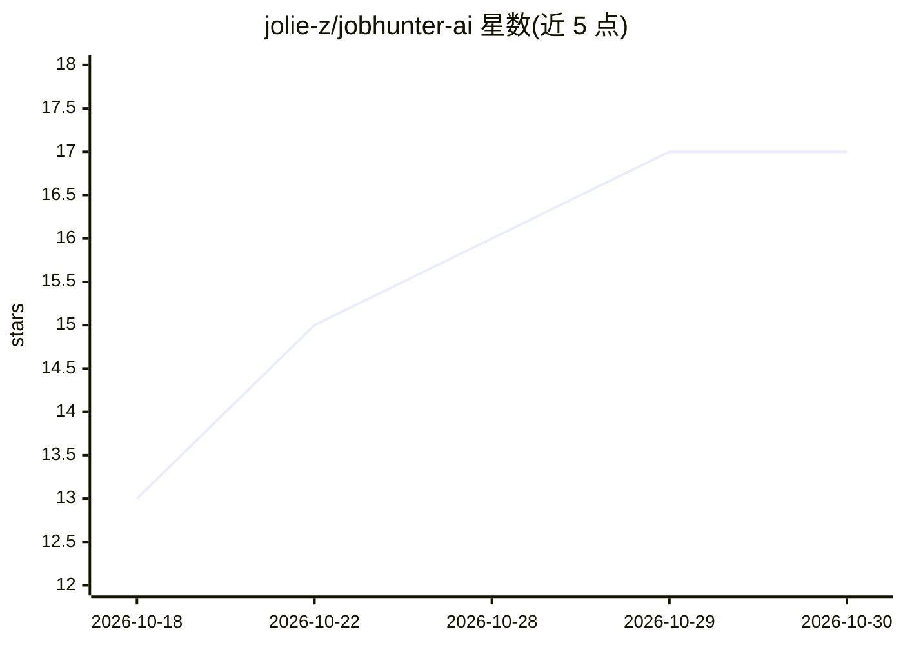

# jolie-z/jobhunter-ai

⭐ 17 · Python · AGPL-3.0 · 推送 2026-10-29 · [GitHub](https://github.com/jolie-z/jobhunter-ai) · 个人维护 · 中文 README

**AI 全链路求职自动化桌面应用：抓取→评估→改写→自动投递**

面向个人求职者的桌面客户端（Windows/macOS 安装包）与本地部署应用：基于 Playwright/DrissionPage 接管真实 Edge 浏览器，抓取 BOSS直聘、51job、猎聘、智联四大平台岗位；经 Tier1 硬规则与 Tier2 LLM 双层清洗后，由 LangGraph 状态机驱动 LLM 评估、STAR 简历改写，并支持自动投递与四平台在线简历回写。通过飞书 ChatOps 在移动端下指令与审批投递。LLM 走 OpenAI 兼容接口（用户自配 API Key）。不支持 Docker 部署，爬虫依赖真实浏览器与人工登录态；macOS 安装包未签名需执行 xattr 解除拦截。

## 筛选速览

| 维度 | 判定 | 备注 |
|---|---|---|
| AI 角色 | `ai-native` | 本体是模型或模型工具 |
| 许可风险 | `dual` | AGPL-3.0 |
| 部署形态 | `desktop` | 安装包/桌面程序 |
| 模型依赖 | — | README 未给出锁定关系 |
| 硬件要求 | — | 无带数字的原话,不猜 |
| 安装摩擦 | `low` | 无编译、无系统依赖或容器化 |
| 成熟度 | — | 结构信号不足 |

## 能力要点

- 四大招聘平台岗位抓取、自动投递与在线简历回写
- LangGraph 状态机驱动的 LLM 评估→STAR 简历改写→审批→投递流水线
- 飞书 ChatOps：聊天指令、定时战报推送、移动端一键放行
- 100% 本地端侧运行（SQLite），LLM 调用前可开启敏感信息脱敏

## 适用场景

- 自动巡航多个招聘平台并清洗过滤岗位线索
- 让 LLM 按目标岗位 JD 定向改写简历后投递
- 在手机飞书里查看求职进展并审批投递意向
- 模拟面试训练与公司背景调查

## 场景标签

`浏览器自动化` `网页抓取` · 领域:效率与自动化

## 证据(README 行号)

> L104: > 从抓取、清洗、评估、改写、审批到最终投递，全流程 9 大阶段自动巡航，支持 DeepSeek-v4.1 flash、mimo v2.6 flash等国产大模型矩阵推理：
> L150: |🧠 AI 评估与改写|LangGraph 状态机驱动的评估→改写/快速话术→审批→投递流水线，支持 A/B 级深度改写与 C-F 级海投话术|
> L295: - 🔒 **100% 本地端侧运行**：你的简历文本、个人经历、手机邮箱、平台登录 Cookie、求职沟通记录均严格存储在你的本地 SQLite 数据库与持久化目录中，**绝不建立任何第三方中央服务器收集你的隐私**。

## 星数曲线

2026-10-18 13 → 2026-10-30 17（+4）

---
*卡片 v1 · prompt 1.4 · 生成 2026-10-30 · 置信度 high · 依据 README sha `4e232f893afa` · [字段定义](../../DATASET.md)*
