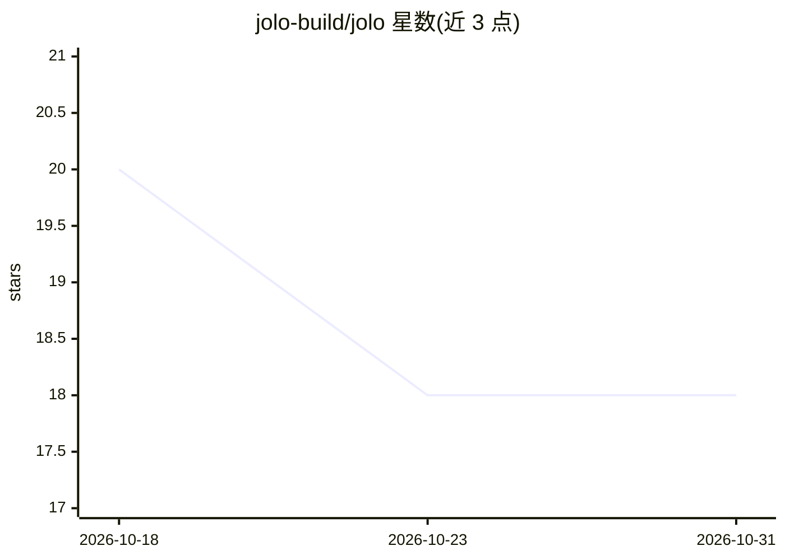

# jolo-build/jolo

⭐ 18 · JavaScript · MIT · 推送 2026-10-28 · [GitHub](https://github.com/jolo-build/jolo) · [官网](https://jolo.build) · 组织维护

**面向 AI 编程 agent 的桌面工作台与终端 CLI**

以 Electron 桌面应用与 CLI 两种形态运行各类编程 agent（Claude Code、Codex、Devin CLI、Grok CLI、Antigravity CLI 或自定义 API provider），把聊天、文件、终端与浏览器整合进一个工作区。核心机制：多任务并行与独立 Git worktree、按步骤选 agent 的计划执行、`^` 委派子任务给指定模型（最多四个子任务、子任务不可再嵌套）、心跳式定时提示。桌面版 macOS/Windows/Linux 有预编译包，macOS 尚未公证且 Windows/Linux 未签名；CLI 经脚本、Homebrew 或 Bun 安装，仅支持 macOS/Linux。

## 筛选速览

| 维度 | 判定 | 备注 |
|---|---|---|
| AI 角色 | `ai-ecosystem` | LLM/agent 周边工具 |
| 许可风险 | `permissive` | MIT |
| 部署形态 | `desktop` | 安装包/桌面程序 |
| 模型依赖 | — | README 未给出锁定关系 |
| 硬件要求 | — | 无带数字的原话,不猜 |
| 安装摩擦 | `low` | 无编译、无系统依赖或容器化 |
| 成熟度 | `idea` | |

## 能力要点

- 统一工作区集成聊天、文件、终端与浏览器
- 多任务并行，独立 Git worktree 与分屏视图
- `^` 选择模型委派子任务，父任务可收集并汇总子任务结果
- 任务心跳：按间隔运行提示以检查被委派工作

## 适用场景

- 在一个界面里同时使用多个编程 agent 处理并行任务
- 制定计划并给每一步指派不同 agent
- 让另一个模型独立审查当前 agent 的改动
- 终端中以 jolo run 单次运行 agent 任务

## 场景标签

`编码 Agent` · 领域:编码与开发

## 证据(README 行号)

> L7: A desktop app and CLI for working with coding agents.
> L9: Use Claude Code, Codex, Devin CLI, Grok CLI, Antigravity CLI, or your own API provider. Keep your chats, files, term

## 星数曲线

2026-10-18 20 → 2026-10-31 18（-2）

---
*卡片 v1 · prompt 1.4 · 生成 2026-10-29 · 置信度 high · 依据 README sha `b8ede6222d88` · [字段定义](../../DATASET.md)*
