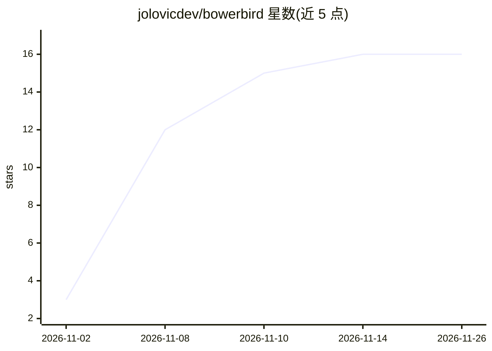

# jolovicdev/bowerbird

⭐ 16 · Rust · MIT · 推送 2026-11-25 · [GitHub](https://github.com/jolovicdev/bowerbird) · 个人维护

**开源本地优先研究笔记应用：问答 PDF/网页/视频，引文逐句核验**

面向研究者的本地优先研究笔记本，定位为开源 NotebookLM 替代品。支持添加 PDF、Word、EPUB、网页、YouTube 字幕与录音（Whisper 本机转录、PP-OCRv5 本机 OCR），提问后回答带引用，且每个引语会在其所引来源中回查核验，未找到或来源错误的引语标记为 unverified。检索融合 SQLite FTS5 关键词与 EmbeddingGemma 向量；笔记本是磁盘上的普通文件夹。模型可任选（默认 DeepSeek），支持 Ollama 本地运行；提供 Linux/macOS/Windows 桌面端、Android 端、Web 服务端与 Docker 镜像。OCR 目前仅支持拉丁字母，不含西里尔等文字。

## 筛选速览

| 维度 | 判定 | 备注 |
|---|---|---|
| AI 角色 | `ai-native` | 本体是模型或模型工具 |
| 许可风险 | `permissive` | MIT |
| 部署形态 | `desktop` | 安装包/桌面程序 |
| 模型依赖 | local-ok | 支持本地模型 |
| 硬件要求 | — | 无带数字的原话,不猜 |
| 安装摩擦 | `low` | 无编译、无系统依赖或容器化 |
| 成熟度 | — | 结构信号不足 |

## 能力要点

- 引文核验：每条引语在其所引来源中回查，未命中标记 unverified 并计数
- 本地优先：笔记、索引、OCR、转录、语音均在本地，README 明确列出全部外发数据
- 关键词（FTS5/BM25）与 EmbeddingGemma 向量检索按倒数排名加权融合
- 学习材料生成：闪卡（Anki 导出）、测验、思维导图、PPTX、四格式音频概览（Kokoro 本机配音）

## 适用场景

- 把论文、书籍、网页和视频汇总进一个笔记本做带引用的问答研究
- 核验 AI 回答中的引语是否真的存在于原始来源
- 在完全本地（Ollama/自建服务器）模式下管理私有研究资料

## 场景标签

`文档问答` `知识库管理` `科研工具` · 领域:知识与检索

## 证据(README 行号)

> L3: An open-source NotebookLM alternative where your files stay yours and every
> L6: Add PDFs, books, web pages, YouTube videos and recordings, then ask
> L8: looked up in the source it cites. Notebooks are plain folders on your disk,

## 星数曲线

2026-11-02 3 → 2026-11-26 16（+13）

---
*卡片 v1 · prompt 1.4 · 生成 2026-11-18 · 置信度 high · 依据 README sha `3cb7d403109c` · [字段定义](../../DATASET.md)*
