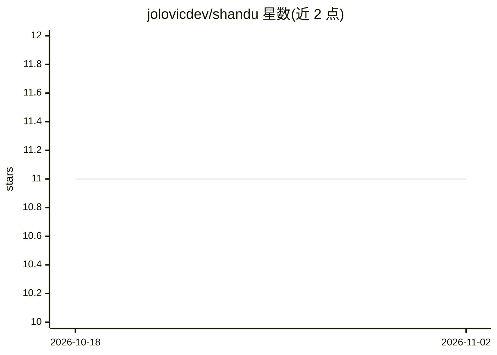

# jolovicdev/shandu

⭐ 11 · Python · MIT · 推送 2026-10-30 · [GitHub](https://github.com/jolovicdev/shandu) · [官网](https://pypi.org/project/shandu/) · 个人维护

**开源深度研究 agent：LLM 多智能体搜索网络并写出带引用报告**

Shandu 是 Python 编写的深度研究代理：主 orchestrator 规划迭代研究循环，并行搜索子代理执行网络搜索与证据抽取，抓取网页与 PDF/DOCX 等文档，对每个来源按类型分类并给出可信度评分，最终生成带编号引用的 markdown 长报告。通过 LiteLLM 接入任意模型（DeepSeek、OpenRouter、Anthropic、OpenAI 或本地端点），以 pipx/pip 安装，提供终端 CLI 与 Gradio Web GUI 两种使用方式。

## 筛选速览

| 维度 | 判定 | 备注 |
|---|---|---|
| AI 角色 | `ai-native` | 本体是模型或模型工具 |
| 许可风险 | `permissive` | MIT |
| 部署形态 | `library` | 以包/库形式分发 |
| 模型依赖 | — | README 未给出锁定关系 |
| 硬件要求 | — | 无带数字的原话,不猜 |
| 安装摩擦 | `low` | 无编译、无系统依赖或容器化 |
| 成熟度 | — | 结构信号不足 |

## 能力要点

- 迭代研究循环：计划-搜索-综合-重复，并行搜索子代理
- 逐页来源分类与 credibility_score 评分，引用账本确定性构建
- 三层 HTML 抽取（trafilatura/readability-lxml/BS4），支持 PDF/DOCX/XLSX/CSV 等文档
- CLI 与 Gradio GUI 双界面，GUI 提供实时遥测与成本显示

## 适用场景

- 提问后自动多轮搜索网络并产出带引用的研究报告
- 快速模式 aisearch 生成带来源引用的单次回答
- 通过 GUI 实时查看子代理任务进度与引用账本

## 场景标签

`科研工具` `多智能体` · 领域:Agent 开发

## 证据(README 行号)

> L3: Shandu is a Python deep research agent: ask a question, and a team of LLM agents
> L6: citations. It is open source and runs on your own machine with any model
> L8: Built on the Blackgeorge agent framework, usable from a terminal CLI or a

## 星数曲线

2026-10-18 11 → 2026-11-02 11（+0）

---
*卡片 v1 · prompt 1.4 · 生成 2026-11-02 · 置信度 high · 依据 README sha `a959c0b4b07d` · [字段定义](../../DATASET.md)*
