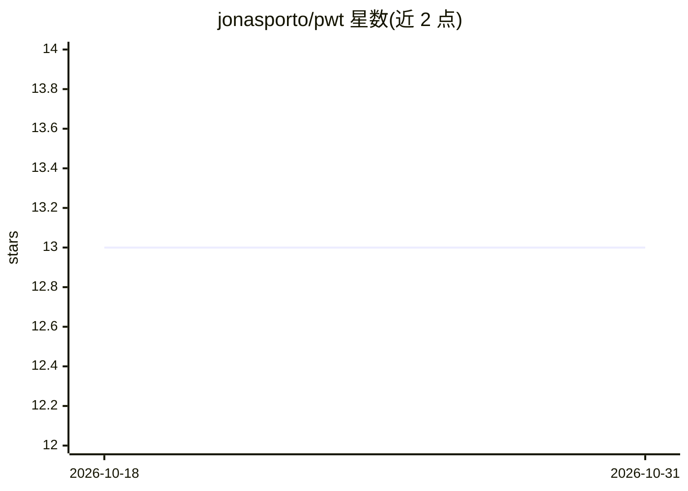

# jonasporto/pwt

⭐ 13 · Shell · MIT · 推送 2026-10-30 · [GitHub](https://github.com/jonasporto/pwt) · [官网](https://jonasporto.github.io/pwt/) · 个人维护

**面向多项目与 AI agent 的 Git worktree 工作流 CLI：端口分配与生命周期管理**

基于 Git worktrees 的命令行工具，为每个 worktree 分配机器级唯一端口，通过 Pwtfile 定义 setup、server、test 等项目钩子，支持后台任务（pwt jobs）、稳定符号链接路径（pwt use）、按需启停的 router/gateway 与全量 --porcelain/--json 输出。面向同时开发多项目或同一项目并行分支的开发者，特别针对 Claude Code、Codex、Cursor 等 AI 编码工具各自建 worktree 的场景，提供统一的 Pwtfile 定义与 pwt adopt 登记机制。限制：依赖 git，gateway/router 需 node。

## 筛选速览

| 维度 | 判定 | 备注 |
|---|---|---|
| AI 角色 | `ai-ecosystem` | LLM/agent 周边工具 |
| 许可风险 | `permissive` | MIT |
| 部署形态 | `library` | 以包/库形式分发 |
| 模型依赖 | — | README 未给出锁定关系 |
| 硬件要求 | — | 无带数字的原话,不猜 |
| 安装摩擦 | `low` | 无编译、无系统依赖或容器化 |
| 成熟度 | — | 结构信号不足 |

## 能力要点

- 机器级端口分配，$PWT_PORT 注入钩子，pwt ports 展示全部占用与冲突
- Pwtfile 定义项目生命周期命令（setup/server/test 等），Makefile 式钩子
- pwt adopt 登记其他工具创建的 worktree 并补端口与元数据
- 后台任务、server wait、boot 进度 JSON 流与稳定退出码契约

## 适用场景

- 在多个分支或项目间并行开发而不换编辑器
- 让 Claude Code/Codex 等 agent 用统一方式创建隔离 worktree
- 避免多项目 dev server 端口冲突，按需启动节省内存

## 场景标签

 · 领域:开发工具/版本控制工作流

## 证据(README 行号)

> L63: ## One setup, every agent
> L65: Claude Code, Codex, Cursor and the rest each create worktrees their own way,
> L68: Pwtfile and every tool lands on the same ready checkout, with its own port,

## 星数曲线

2026-10-18 13 → 2026-10-31 13（+0）

---
*卡片 v1 · prompt 1.4 · 生成 2026-10-31 · 置信度 mid · 依据 README sha `943d04538513` · [字段定义](../../DATASET.md)*
