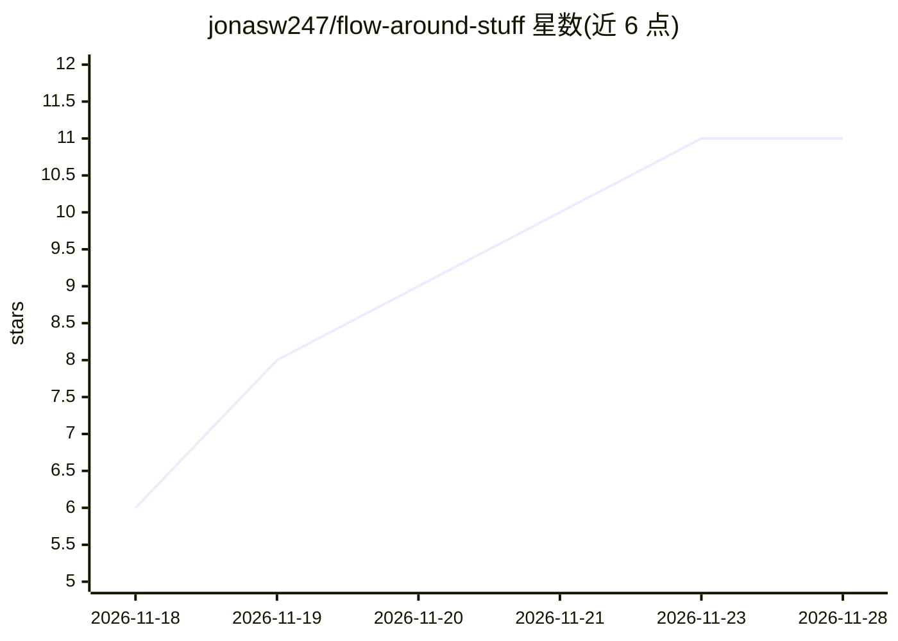

# jonasw247/flow-around-stuff

⭐ 11 · Python · CC-BY-4.0 · 推送 2026-11-16 · [GitHub](https://github.com/jonasw247/flow-around-stuff) · [官网](https://flow-around-stuff.com) · 个人维护

**从 3D 表面网格快速预测物体周围气流的推理模型**

fas 模型接收任意三维物体的表面网格，预测定常不可压缩流动：表面压力与摩擦、升力与阻力，以及任意点的压力、速度和涡量。输入网格可读取 trimesh 支持的任意格式，支持设置雷诺数、移动地面（如车辆场景）与参考面积。权重（1 GB）首次运行时从 Hugging Face 下载，需先在该页面申请访问。提供 CLI 与 Python API，仅含推理，不含训练代码。结果为学习模型的估计而非仿真。

## 筛选速览

| 维度 | 判定 | 备注 |
|---|---|---|
| AI 角色 | `ai-native` | 本体是模型或模型工具 |
| 许可风险 | `viral` | CC-BY-4.0 |
| 部署形态 | `library` | 以包/库形式分发 |
| 模型依赖 | — | README 未给出锁定关系 |
| 硬件要求 | — | 无带数字的原话,不猜 |
| 安装摩擦 | `low` | 无编译、无系统依赖或容器化 |
| 成熟度 | — | 结构信号不足 |

## 能力要点

- 从表面网格预测表面压力、摩擦、阻力与升力
- CLI 与 Python API 两种使用方式，支持 trimesh 可读的任意网格格式
- 256M 参数，基于球组 token 的 transformer 架构
- GPU 推荐，也可在 CPU 上运行

## 适用场景

- 快速估计汽车或机翼外形的风阻与升力系数
- 在设计迭代中获取任意点位的流场数值
- 评估物体在不同雷诺数下的气动特性

## 场景标签

 · 领域:科学计算/流体力学代理模型

## 证据(README 行号)

> L3: `fas` predicts the steady incompressible flow around a body from its surface mesh: surface pressure and friction, dr
> L36: 256 M parameters. Points around the body are grouped into balls; a transformer over the ball tokens predicts the fi

## 星数曲线

2026-11-18 6 → 2026-11-28 11（+5）

---
*卡片 v1 · prompt 1.4 · 生成 2026-11-20 · 置信度 high · 依据 README sha `cdbe0b92d062` · [字段定义](../../DATASET.md)*
