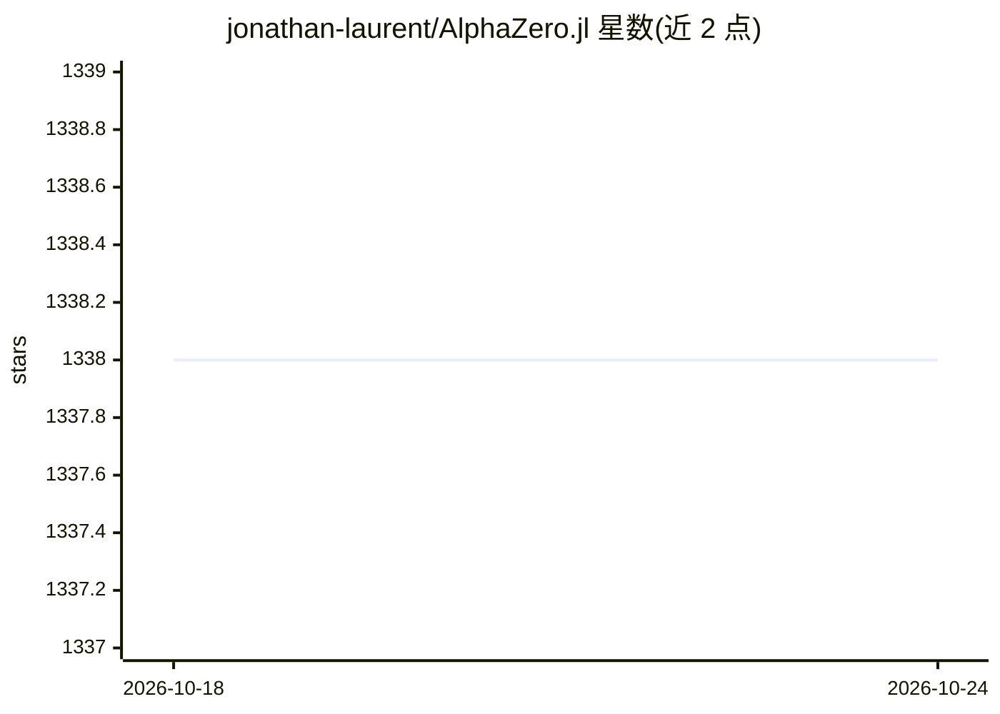

# jonathan-laurent/AlphaZero.jl

⭐ 1,338 · Julia · MIT · 推送 2026-09-09 · [GitHub](https://github.com/jonathan-laurent/AlphaZero.jl) · [官网](https://jonathan-laurent.github.io/AlphaZero.jl/stable/) · 个人维护

**Julia 编写的通用 AlphaZero 算法实现，供研究与教学训练游戏智能体**

用约 2,000 行纯 Julia 代码实现 DeepMind 的 AlphaZero 算法，核心定位是通用、可改写的参考实现。提供通用接口以接入新游戏或新学习框架，支持在单机（含桌面级 GPU）或机器集群上训练同一智能体且无需改代码。面向学生、研究者与爱好者，降低使用门槛的同时保留在有限算力上做有意义实验的能力。README 给出 Connect Four 智能体的完整训练流程，训练基于自我对弈、无监督与先验知识，相关研究工作受美国空军与 DARPA 合同支持。

## 筛选速览

| 维度 | 判定 | 备注 |
|---|---|---|
| AI 角色 | `ai-native` | 本体是模型或模型工具 |
| 许可风险 | `permissive` | MIT |
| 部署形态 | `None` |  |
| 模型依赖 | — | README 未给出锁定关系 |
| 硬件要求 | — | 无带数字的原话,不猜 |
| 安装摩擦 | `low` | 无编译、无系统依赖或容器化 |
| 成熟度 | — | 结构信号不足 |

## 能力要点

- 核心算法仅约 2,000 行纯 Julia 代码，可改写
- 通用接口支持新增游戏与学习框架
- 同一智能体可在单机或集群上训练且无需修改代码
- 提供 Connect Four 完整训练教程与基线对比实验

## 适用场景

- 在桌面级 GPU 上训练 Connect Four 等棋类智能体
- 研究学习与搜索结合的组合空间探索方法
- 通过通用接口为自己的游戏或环境接入 AlphaZero 训练

## 场景标签

`强化学习` `教程课程` · 领域:学习与行业

## 证据(README 行号)

> L11: This package provides a _generic_, _simple_ and _fast_ implementation of
> L14: * The core algorithm is only 2,000 lines of pure, hackable Julia code.
> L58: Each training iteration takes about one hour on a desktop

## 星数曲线

2026-10-18 1,338 → 2026-10-24 1,338（+0）

---
*卡片 v1 · prompt 1.4 · 生成 2026-10-21 · 置信度 high · 依据 README sha `f5d4900b894e` · [字段定义](../../DATASET.md)*
